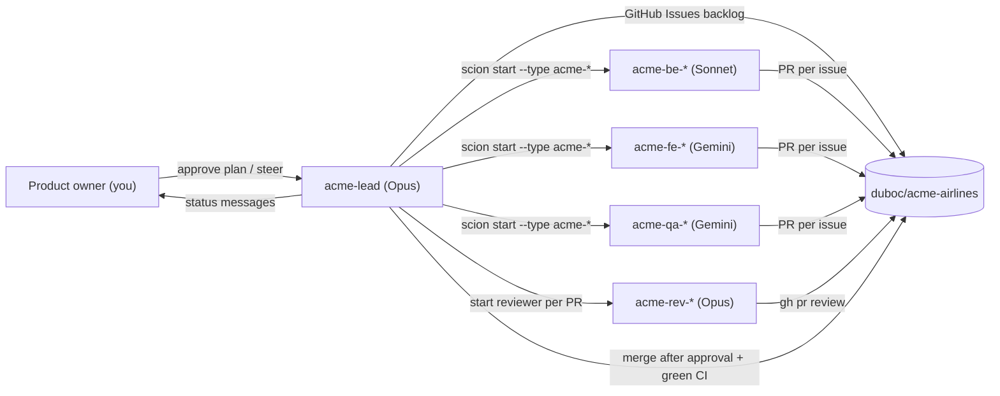

# The factory crew — how to work with the agent team

The team is five Scion role templates, generated from `factory/team/` by
`infra/40-build-team-templates.sh` into `.scion/templates/acme-*` and pushed to
the hub at **global** scope. Design: [addendum A](../superpowers/specs/2026-10-09-addendum-a-agent-team.md).

| Role | Template | Harness / model | Hub agent role |
|------|----------|-----------------|----------------|
| Lead / tech lead | `acme-lead` | claude / Opus 5.5 (`large`) | `full` (can spawn and manage agents) |
| Backend developer | `acme-backend` | claude / Sonnet 5.5 (`medium`) | `baseline` |
| Frontend developer | `acme-frontend` | antigravity / Gemini Pro (`large`) | `baseline` |
| QA / test engineer | `acme-qa` | antigravity / Gemini Pro (`large`) | `baseline` |
| Code reviewer | `acme-reviewer` | claude / Opus 5.5 (`large`) | `baseline` |

Claude templates set `ANTHROPIC_DEFAULT_HAIKU_MODEL=claude-haiku-5-5`, because
the harness default `claude-haiku-4-5` is not enabled on Vertex. All model
traffic goes to Vertex AI `global` using the VM service account.

## How the team works



1. **Phase 0 (planning).**
   - The lead opens a PR on `docs/mvp-plan` with the stack ADR
     (`docs/decisions/0100-app-stack.md`), `docs/product/mvp-plan.md` and the
     MVP issues.
   - A reviewer agent reviews it.
   - The lead messages you, then **waits for your approval**: approve or merge
     the PR, or message the lead.
2. **Delivery loop.**
   - The lead runs at most 4 workers at once.
   - Each issue gets one branch and one PR, reviewed by `acme-reviewer`.
   - The lead merges only with reviewer approval **and** green CI.

## Talking to the team

**Web UI:** <https://scion-hub-acme-iap-proxy-vdhcml5ceq-uc.a.run.app>, project
**acme-airlines**. From there you can open the lead, read its terminal, send it
messages and see every agent.

**Your inbox:** the lead sends you messages (`@admin@duboc.altostrat.com`).
Reply in the web UI conversation.

**Steering examples** (send to `acme-lead`):
- "Approved — start the delivery loop."
- "Scope MVP to scenarios 1–3 first; defer the upsell."
- "Pause all workers." / "Resume."

**CLI** (for operators, from the laptop): enable admin access, then:

```bash
infra/30-hub-admin-access.sh enable
bash -c 'source infra/lib.sh; hub_cli list --project duboc-acme-airlines'
bash -c 'source infra/lib.sh; hub_cli look acme-lead --project duboc-acme-airlines'
bash -c 'source infra/lib.sh; hub_cli message acme-lead --project duboc-acme-airlines "status?"'
infra/30-hub-admin-access.sh disable
```

## Changing the team

1. Edit `factory/team/team-rules.md` or `factory/team/roles/<role>.md`, or
   change the role table in `infra/40-build-team-templates.sh`.
2. Run `infra/40-build-team-templates.sh` and commit the regenerated
   `.scion/templates/acme-*`.
3. Push to the hub. With admin access enabled, copy the templates into the
   VM's `~/.scion/templates/`, then run `hub_cli --global templates push acme-<role>`
   for each role. See runbook §5.
4. New agents pick up the change. Running agents keep their old instructions;
   ask the lead to recycle them.

## Stopping everything

Ask the lead to stop all workers. Or, as operator:
`hub_cli stop <agent> --project duboc-acme-airlines` / `hub_cli delete <agent> …`.
To stop all compute, stop the VM (see [operations](../setup/02-operations.md)).
