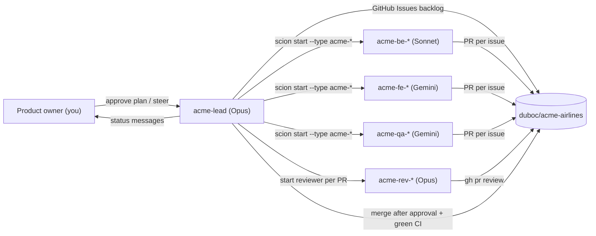
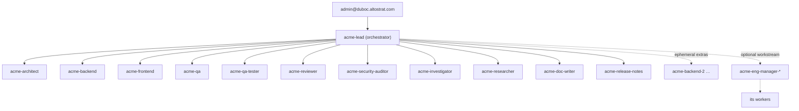

# The factory crew — how to work with the agent team

The team is thirteen Scion role templates, generated from `factory/team/` by
`infra/40-build-team-templates.sh` into `factory/templates/acme-*` and pushed to
the hub at **global** scope. Design: [addendum A](../superpowers/specs/2026-10-09-addendum-a-agent-team.md).

| Role | Template | Harness / model | Hub agent role | Cap |
|------|----------|-----------------|----------------|-----|
| Lead / tech lead | `acme-lead` | claude / **Opus 5.5** | `full` | — |
| Engineering manager | `acme-eng-manager` | claude / **Opus 5.5** | `full` | 4h |
| Architect | `acme-architect` | claude / **Opus 5.5** | `baseline` | 1h |
| Backend developer | `acme-backend` | claude / **Sonnet 5.5** | `baseline` | 2h |
| Frontend developer (+ **impeccable**) | `acme-frontend` | claude / **Sonnet 5.5** | `baseline` | 2h |
| QA / test engineer | `acme-qa` | claude / **Sonnet 5.5** | `baseline` | 2h |
| Code reviewer | `acme-reviewer` | antigravity / **Gemini Flash** | `baseline` | 45m |
| Security auditor | `acme-security-auditor` | antigravity / **Gemini Flash** | `baseline` | 45m |
| QA tester (Playwright) | `acme-qa-tester` | antigravity / **Gemini Flash** | `baseline` | 45m |
| Investigator | `acme-investigator` | antigravity / **Gemini Flash** | `baseline` | 30m |
| Researcher | `acme-researcher` | antigravity / **Gemini Flash** | `baseline` | 30m |
| Documentation writer | `acme-doc-writer` | antigravity / **Gemini Flash** | `baseline` | 30m |
| Release engineer | `acme-release-notes` | antigravity / **Gemini Flash** | `baseline` | 30m |

The lead runs at most **4 agents** at once besides itself, counting
eng-managers and their workers. When to use which role is in
`factory/team/roles/lead.md`.

Claude templates set `ANTHROPIC_DEFAULT_HAIKU_MODEL=claude-haiku-5-5`, because
the harness default `claude-haiku-4-5` is not enabled on Vertex. All model
traffic goes to Vertex AI `global` using the VM service account.

## How the team works



1. **Phase 0 (planning).**
   - The lead opens a PR on `docs/mvp-plan` with the stack ADR
     (`docs/decisions/0100-app-stack.md`), `docs/product/mvp-plan.md` and the
     MVP issues.
   - A reviewer agent reviews it.
   - The lead messages you, then **waits for your approval**: approve or merge
     the PR, or message the lead.
> [!WARNING]
> All agents act as one GitHub user (the token owner), so there are two gaps:
> - **No formal approvals.** Reviews are comment reviews starting with
>   `VERDICT: APPROVE` or `VERDICT: REQUEST CHANGES`.
> - **No branch protection** on this private repo's plan.
>
> See [ADR 0006](../decisions/0006-github-fine-grained-pat.md) for the risk and
> the options.

2. **Delivery loop.**
   - The lead runs at most 4 workers at once.
   - Each issue gets one branch and one PR, reviewed by `acme-reviewer`.
   - The lead merges only with reviewer approval **and** green CI.

## The autonomous loop

- **Work bus.** Everything happens in **GitHub Issues**. Read the pinned
  issue **🏭 Factory status** for the live picture.
- **Labels.** `status:*`, `agent:*`, `priority:*` and `role:*` track each
  issue.
- **Comments.** Agents write structured `[agent] STATUS/DONE/NEXT/BLOCKER`
  comments, and file new work as `status:triage`.
- **Wake-ups.** The lead wakes on worker events and on the 30-minute
  `acme-factory-tick`. Each pass, it merges what's approved and green,
  triages, and dispatches.
- **Your inbox.** The lead messages you **only** when the backlog is empty.
  Send more backlog by filing issues or messaging `acme-lead`.
- **Cost.** `infra/60-factory.sh pause|resume` (the VM is never stopped), plus the $1000
  budget guard (see [operations](../setup/02-operations.md)).

## Seeing the topology in the UI

Open the hub, then **Projects → acme-airlines → Agents** and switch to the
**graph** view (the lineage graph). You can also use the top-level **Agents**
page. Press `t` to flip between vertical and horizontal, and `f` to fit.



How the tree stays in place:

- **Lineage is automatic.** An agent's parent is whoever started it. The lead
  starts every `acme-*` agent, so all of them sit under it. An eng-manager's
  workers sit one level below the eng-manager.
- **Standing roster.** There is one persistent agent per role, named exactly
  like its template.
  - Idle agents are **suspended** (or **stopped**, if their harness can't
    suspend). They use no CPU but stay in the graph.
  - The lead assigns work with `scion message --wake <agent> "<issue>"`.
  - Standing agents are never deleted.
- **Ephemeral extras** (`acme-<role>-2…`) appear for parallel work and
  disappear when their PR merges.
- **Labels.** Every agent carries `acme.team/role=<role>` and
  `acme.team/tier=standing|ephemeral`, so you can filter by them in the UI.
- **Check.** `infra/verify.sh topology` confirms that every live `acme-*`
  agent descends from `acme-lead`, and that at least 11 exist.

If an agent shows up **outside** the lead's tree, someone started it directly.
Ask the lead to adopt the work, then delete the stray agent.

## Talking to the team

**Web UI:** <https://scion-hub-acme-iap-proxy-vdhcml5ceq-uc.a.run.app>, project
**acme-airlines**. From there you can open the lead, read its terminal, send it
messages and see every agent.

**Your inbox:** the lead sends you messages (`@admin@duboc.altostrat.com`).
Reply in the web UI conversation.

**Steering examples** (send to `acme-lead`):
- "Approved — start the delivery loop."
- "Scope MVP to scenarios 1–3 first; defer the upsell."
- "Pause all workers." / "Resume."

**CLI** (for operators, from the laptop): enable admin access, then:

```bash
infra/30-hub-admin-access.sh enable
bash -c 'source infra/lib.sh; hub_cli list --project duboc-acme-airlines'
bash -c 'source infra/lib.sh; hub_cli look acme-lead --project duboc-acme-airlines'
bash -c 'source infra/lib.sh; hub_cli message acme-lead --project duboc-acme-airlines "status?"'
infra/30-hub-admin-access.sh disable
```

## Changing the team

1. Edit `factory/team/team-rules.md` or `factory/team/roles/<role>.md`, or
   change the role table in `infra/40-build-team-templates.sh`.
2. Run `infra/40-build-team-templates.sh` and commit the regenerated
   `factory/templates/acme-*`.
3. Push to the hub. With admin access enabled, copy the templates into the
   VM's `~/factory/templates/`, then run `hub_cli --global templates push acme-<role>`
   for each role. See runbook §5.
4. New agents pick up the change. Running agents keep their old instructions;
   ask the lead to recycle them.

## Stopping everything

Ask the lead to stop all workers. Or, as operator:
`hub_cli stop <agent> --project duboc-acme-airlines` / `hub_cli delete <agent> …`.
To stop all token spend, run `infra/60-factory.sh pause`; the VM and hub stay up (see [operations](../setup/02-operations.md)).
