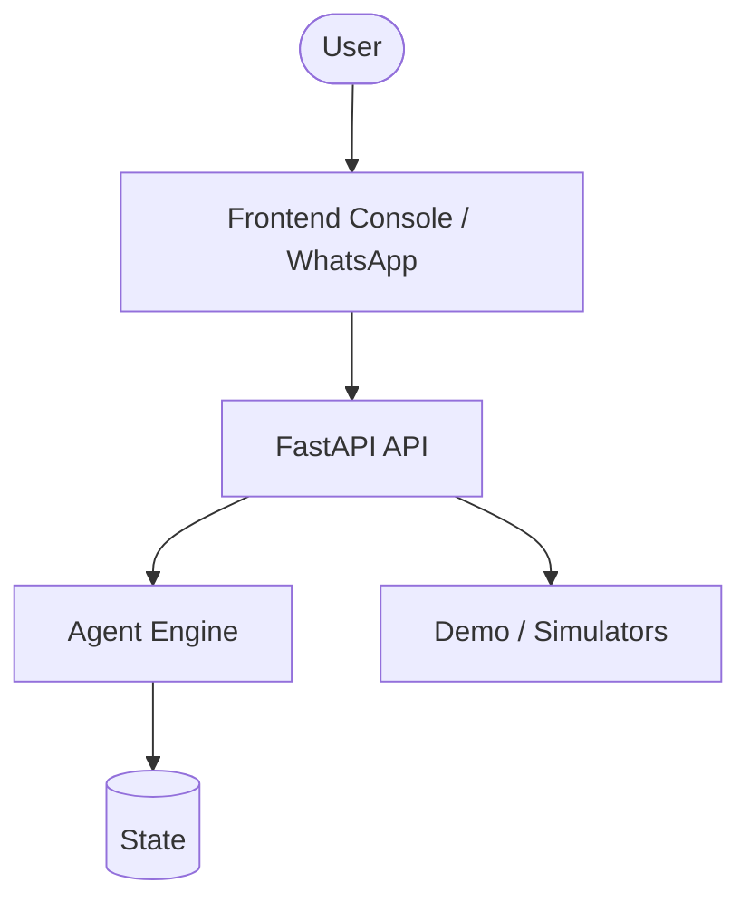
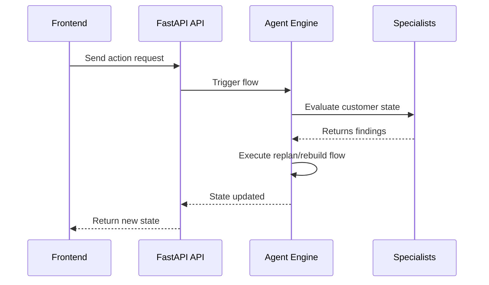

# Architecture Document

This document outlines the architecture layers of the ACME Airlines system, including how the components interact, and where to find the source code.

## Related Documentation
- [Root Deployment](../../DEPLOYMENT.md)
- [Agents List](../../AGENTS.md)
- [ADR-0103 Stateless Engine Scenarios](./adr-0103-stateless-engine-scenarios.md)
- [Deploy](./deploy.md)
- [Engines](./engines.md)
- [Irrops Use Case](./irrops-use-case.md)
- [Policy Rules](./policy-rules.md)
- [Release Notes v0.1.0](./release-notes-v0.1.0.md)
- [Release Notes v0.2.0](./release-notes-v0.2.0.md)
- [Simulators](./simulators.md)
- [Test Strategy](./test-strategy.md)
- [Try It](./try-it.md)

## System Context Diagram

## Layers

### Frontend (Console / WhatsApp)
The frontend is a React + Vite application found in `app/frontend/`.
- **Operator Console:** Located in `app/frontend/src/console/`.
- **WhatsApp Emulator:** Located in `app/frontend/src/whatsapp/`.
- **Demo Scenarios:** Used to trigger end-to-end flows.

### FastAPI API
The main backend service is built with FastAPI. It handles incoming requests and coordinates with other services.
- **Source Code:** `app/backend/src/acme/api/`

### ADK Agents / Specialists + A2A Communication
Agents interact using the Agent Development Kit (ADK) and communicate via Agent-to-Agent (A2A) protocols.
- **Specialists:** Implement logic for specific tasks. Source: `app/backend/src/acme/customer/specialists/`

### Policy Engine
The policy engine ensures actions follow business rules.
- **Source Code:** `app/backend/src/acme/policy/`

### Customer Outreach
Handles communications directly with the customer.
- **Source Code:** `app/backend/src/acme/customer/`

### Demo / Simulators
Simulates external airline systems (e.g., DCS, loyalty) for demonstrations.
- **Source Code:** `app/backend/src/acme/sim/`

### Agent Engine
Orchestrates agent tasks and execution flows. Manages replanning and rebuilding.

### Cloud Run + IAP
Infrastructure as code for deploying to Google Cloud using Cloud Run with Identity-Aware Proxy (IAP) for security.
- **Deployment Scripts:** `infra/`
- **Key Files:** `infra/setup-scion.sh`, `infra/60-factory.sh`

### CI Workflows
GitHub Actions are used to automate continuous integration and deployment.
- **Workflows:** `.github/workflows/`

### Telemetry
OpenTelemetry is used to collect metrics and distributed traces, sending them to Google Cloud.
- **Tracing:** `app/backend/src/acme/telemetry.py`
- **Metrics:** `app/backend/src/acme/metrics.py`

## Sequence Diagram: Request to Replan/Rebuild Flow

