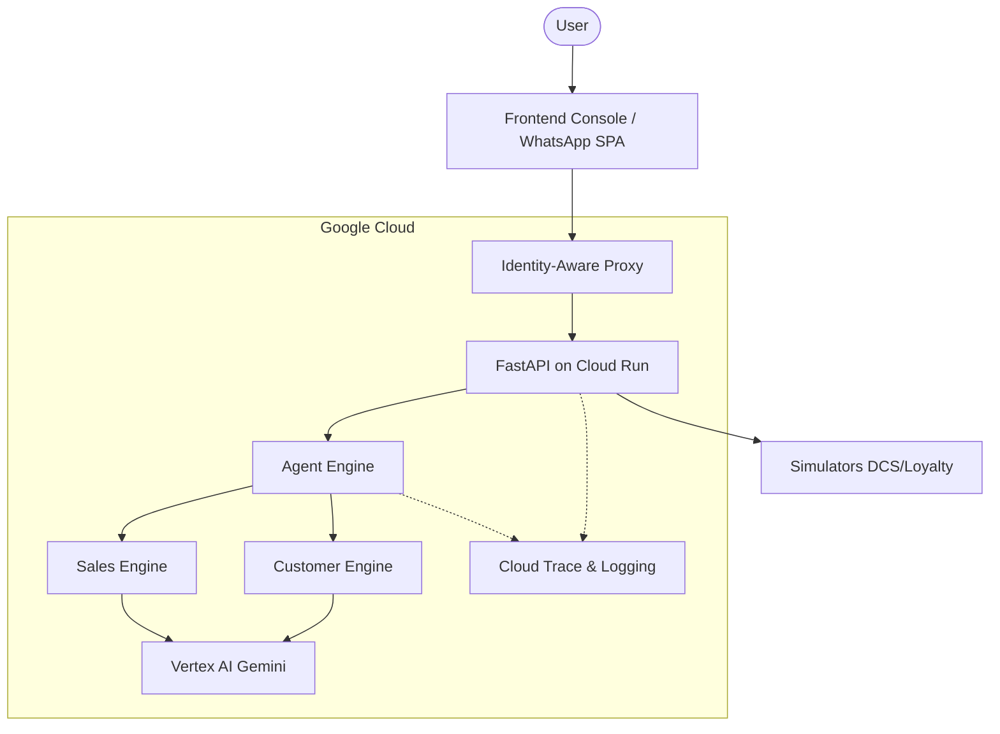
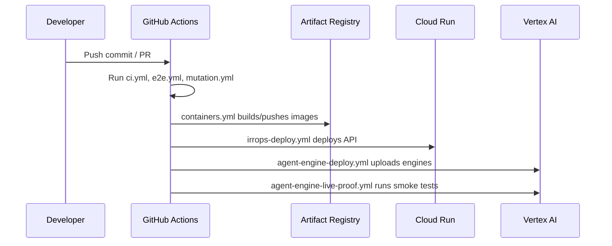

# Architecture Document

This document outlines the architecture layers of the ACME Airlines system, including how components interact, and where to find the source code.

## Related Documentation
- [Root Deployment](../../DEPLOYMENT.md)
- [Agents List](../../AGENTS.md)
- [ADR-0103 Stateless Engine Scenarios](./adr-0103-stateless-engine-scenarios.md)
- [Deploy](./deploy.md)
- [Engines](./engines.md)
- [Irrops Use Case](./irrops-use-case.md)
- [Policy Rules](./policy-rules.md)
- [Release Notes v0.1.0](./release-notes-v0.1.0.md)
- [Release Notes v0.2.0](./release-notes-v0.2.0.md)
- [Simulators](./simulators.md)
- [Test Strategy](./test-strategy.md)
- [Try It](./try-it.md)

## System Context Diagram



## Layers

### Frontend (Console / WhatsApp)
The frontend is a React + Vite application found in `app/frontend/`.
- **Operator Console:** Located in `app/frontend/src/console/`.
- **WhatsApp Emulator:** Located in `app/frontend/src/whatsapp/`.
- **Demo Scenarios:** Guided tours (`app/frontend/src/demo/`).

### FastAPI API
The main backend is built with FastAPI. It handles incoming requests, orchestrates scenarios, and provides Server-Sent Events (SSE) updates.
- **Source Code:** `app/backend/src/acme/api/`

**FastAPI Modules & Routes:**
- `app/backend/src/acme/api/app.py`: FastAPI instantiation, configures the backend switch, and defines core routes:
  - /healthz (Health check)
  - /a2a (Agent-to-Agent listener)
  - /scenario/reset, /scenario/trigger-cancellation
  - /scenarios, /scenarios/{scenario_id}/start, /scenarios/{scenario_id}/step
  - /journeys, /journeys/{journey_id}
  - /whatsapp/{passenger_id}/messages, /whatsapp/{passenger_id}/actions
- `app/backend/src/acme/api/events.py`: Typed timeline events for OpenAPI contracts.
- `app/backend/src/acme/api/sse.py`: Server-Sent Events implementation serving /journeys/{journey_id}/events.
- `app/backend/src/acme/api/scenarios.py`: Scenario runner and evaluation logic.
- `app/backend/src/acme/api/openapi.py`: Custom OpenAPI schema generation.

### ADK Agents & A2A Communication
Agents are built with the Google Agent Development Kit (ADK) and interact via Agent-to-Agent (A2A) protocols. A2A carries capabilities, inputs, and payloads between the Customer and Sales agents.

- **Customer Agent:** The main conversational/orchestration agent (`app/backend/src/acme/customer/adk_agent.py`), backed by skills (`app/backend/src/acme/customer/skills.py`).
- **Specialists:** Focused reasoning modules used by the Customer Agent to evaluate policy and rules:
  - `app/backend/src/acme/customer/specialists/baggage.py`
  - `app/backend/src/acme/customer/specialists/change.py`
  - `app/backend/src/acme/customer/specialists/common.py`
  - `app/backend/src/acme/customer/specialists/concierge.py`
  - `app/backend/src/acme/customer/specialists/duty.py`
  - `app/backend/src/acme/customer/specialists/irrops.py`
  - `app/backend/src/acme/customer/specialists/rights.py`
  - `app/backend/src/acme/customer/specialists/seat.py`
- **Sales Agent:** Proposes margin-opt offers to the Customer Agent (`app/backend/src/acme/sales/agent.py`).
- **A2A Guard (`app/backend/src/acme/api/a2a_guard.py`):** Middleware enforcing that only the Sales Agent (via ACME_SALES_TOKEN) can hit the POST /a2a endpoint, and the Sales Agent token cannot access any other passenger routes.

### Customer Journey Flow
The core IRROPS customer journey state machine lives in `app/backend/src/acme/customer/`.
- The `app/backend/src/acme/customer/loop.py` ticks the state machine forward.
- **Intent (`app/backend/src/acme/customer/intent.py`):** Determines passenger needs.
- **Change & Rebuild (`app/backend/src/acme/customer/change.py`, `app/backend/src/acme/customer/rebuild.py`):** Evaluates rebooking options using the specialists.
- **Verify (`app/backend/src/acme/customer/verify.py`):** Validates the rebooking against policy.
- **Outreach & Quiet Hours (`app/backend/src/acme/customer/outreach.py`, `app/backend/src/acme/customer/quiet_hours.py`):** Contacts the passenger while respecting local time constraints.
- **Closure (`app/backend/src/acme/customer/closure.py`, `app/backend/src/acme/customer/service_closure.py`, `app/backend/src/acme/customer/conversion.py`):** Finalises the journey state.
- **Human Escalation:** If the system cannot resolve the state automatically, it flags needs_human=True for operator intervention.

### Agent Engine
The system can run locally or via Vertex AI Agent Engine, controlled by ENGINE_MODE.
- **Switch:** `app/backend/src/acme/api/app.py` loads `create_engine_app()` from `app/backend/src/acme/api/engine_backend.py` when ENGINE_MODE=agent-engine. This connects to the remote agents rather than local in-memory loops.
- **Engine Deployments:** Definitions for deploying the reasoning engines to Vertex AI live in `app/backend/src/acme/engines/`. Specifically:
  - `app/backend/src/acme/engines/customer.py`
  - `app/backend/src/acme/engines/sales.py`
  - `app/backend/src/acme/engines/stage.py`
  - `app/backend/src/acme/engines/deploy.py`
  (See [ADR-0103](./adr-0103-stateless-engine-scenarios.md) and [Engines](./engines.md)).

### Core Backend Modules
| Path | Responsibility |
| --- | --- |
| `app/backend/src/acme/sales/` | Sales agent, sales radar, and configuration. |
| `app/backend/src/acme/llm/` | LLM bindings (Vertex AI, Tape testing) and config. |
| `app/backend/src/acme/memory/` | In-memory datastores for local runs. |
| `app/backend/src/acme/domain/` | Core domain entities (Journeys, Clock, etc.). |
| `app/backend/src/acme/state/` | Shared state definitions and snapshotting. |
| `app/backend/src/acme/demo/` | Demo scenario supervisors (`app/backend/src/acme/demo/front.py`, `app/backend/src/acme/demo/supervisor.py`). |
| `app/backend/src/acme/runtime/scenario.py` | State structures for scenarios. |
| `app/backend/src/acme/replay.py` | Playback logic for historical traces. |
| `app/backend/src/acme/diagnostics.py` | Diagnostic tools and system probes. |
| `app/backend/src/acme/logging_setup.py` | Centralised logging configuration. |

### Policy & Simulators
- **Policy Engine:** Business rules and guards (`app/backend/src/acme/policy/`).
- **Simulators:** Mocks for external APIs like DCS and loyalty systems (`app/backend/src/acme/sim/`).

### Cloud Run + IAP Infrastructure
Infrastructure scripts configure Google Cloud resources.
- `infra/90-irrops-demo-platform.sh`: Provisions the Cloud Run service and grants demo permissions.
- `infra/95-agent-engine-platform.sh`: Provisions the Agent Engine runtime service account (granting Vertex AI, Cloud Trace, Logging roles) and Agent Engine buckets.
- `infra/50-web-access.sh` & `infra/55-iap-oauth-client.sh`: Configure Identity-Aware Proxy (IAP) access to the services.
- *(Note: The factory setup scripts, `infra/setup-scion.sh` and `infra/60-factory.sh`, are strictly for the agent factory initialization and not runtime infrastructure).*
- **Service Accounts:** Mentions dedicated runtime service accounts such as the irrops-demo and agent-engine accounts by role.

### CI Workflows
Located in `.github/workflows/`, these handle automation:
- `.github/workflows/ci.yml`: Runs tests, linting, and type checks on PRs/push to main.
- `.github/workflows/e2e.yml`: Runs end-to-end Cypress/Playwright tests on PRs.
- `.github/workflows/containers.yml`: Builds and pushes Docker images.
- `.github/workflows/mutation.yml`: Runs mutation testing on backend code.
- `.github/workflows/pr-size.yml`: Enforces pull request size limits.
- `.github/workflows/irrops-deploy.yml`: Deploys the IRROPS backend to Cloud Run.
- `.github/workflows/agent-engine-deploy.yml`: Pushes updated Agent Engine reasoning engines to Vertex AI.
- `.github/workflows/agent-engine-live-proof.yml`: Runs live verification (smoke tests) against deployed Agent Engines.
- `.github/workflows/observatory-ci.yml`: CI checks for the observatory components.
- `.github/workflows/observatory-deploy.yml`: Deploys the observatory components.

## Sequence Diagram: Disruption Request to Replan Flow

```mermaid
sequenceDiagram
    participant SPA as Console/WhatsApp
    participant API as FastAPI
    participant Loop as Customer Loop
    participant Intent as Intent
    participant Spec as Specialists
    participant Verify as Verify
    participant Outreach as Outreach
    
    SPA->>API: POST /scenario/trigger-cancellation
    API->>Loop: Evaluate passenger state
    Loop->>Intent: Determine needs
    Intent-->>Loop: Needs rebooking
    Loop->>Spec: Calculate change/rebuild
    Spec-->>Loop: Rebooking options (e.g. rights, seats)
    Loop->>Verify: Validate options against policy
    Verify-->>Loop: Approved
    Loop->>Outreach: Check quiet hours / send offer
    Outreach-->>Loop: Sent via WhatsApp
    Loop->>API: Update Journey State
    API-->>SPA: Server-Sent Events (SSE) stream updates
```

## Sequence Diagram: CI & Deployment Pipeline


