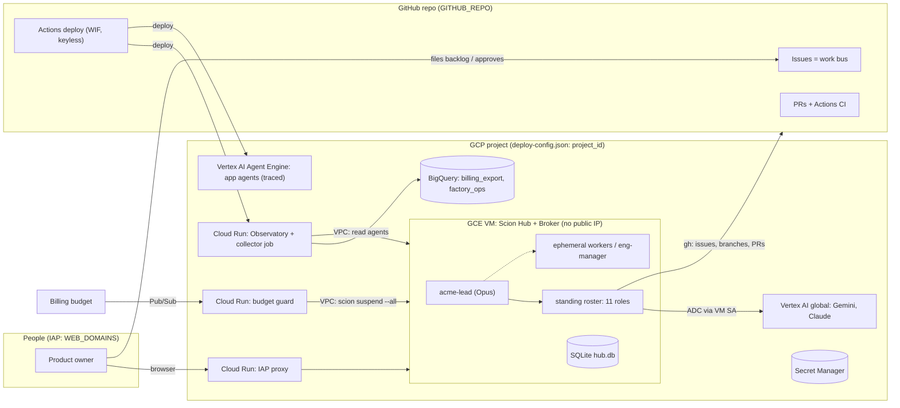

# 1. Architecture

## Components

| Component | Where it runs | Identity | Notes |
|---|---|---|---|
| Scion Hub + Runtime Broker | One GCE VM, systemd `scion-hub` | VM SA `scion-hub-<hub>` | SQLite, local secrets, Docker for agents. Deployed by Scion's `scripts/single-node-vm/deploy.sh` |
| Web/CLI access | Cloud Run IAP proxy | IAP | `auth.mode: proxy`. External domains need a **custom OAuth client** |
| Agents | Docker containers on the VM | Dedicated `acme-agent` SA via metadata sidecar (`assign` mode; Hub default `block`) | Vertex `global` via ADC + Cloud Monitoring/Trace/Logging write only. No API keys |
| GitHub access | Inside agents | Project secret `GITHUB_TOKEN` (fine-grained PAT) | All agents share one GitHub identity (consequences in [04](04-operating-model.md)) |
| Lead loop & watchdog | Cloud Run `acme-factory-watchdog` (`*/5`) + Hub schedule `acme-factory-tick` (`0 */6 * * *`) | `acme-factory-watchdog` SA (project UAT) / Admin user | Wakes `acme-lead` only on GitHub/agent changes, self-heals stalls, reincarnates `acme-lead` daily at `04:00 UTC`, and alerts `ADMIN_EMAIL` |
| Budget guard | Cloud Run `acme-budget-guard` | `acme-budget-guard` SA (no Compute roles) | Budget → Pub/Sub (OIDC push) → `scion suspend --all` over the VPC with a project UAT |
| Observatory | Cloud Run service (IAP) + job (Scheduler) | Read-only SAs | BigQuery + Monitoring + Trace + Logging |
| App agents (optional) | Vertex AI Agent Engine | `acme-agent-engine` SA | `enable_tracing=True`, so traces go to Cloud Trace |
| CD | GitHub Actions | WIF → `acme-observatory-deployer` | Trusts only `GITHUB_REPO@refs/heads/main` |

## Trust boundaries

1. **Internet → IAP.** Only `WEB_DOMAINS` reach any UI. The hub also enforces
   `user_access_mode: domain_restricted` (defence in depth).
2. **Hub API on localhost:8080.** Reachable only from the VM and the default
   subnet (firewall `tcp:8080` from the subnet CIDR). That covers the IAP
   proxy, the guard and the collector over Direct VPC egress.
3. **Operator CLI.** Admin actions use a *temporary* federation trusted issuer
   (`infra/30-hub-admin-access.sh enable|disable`), and run on the VM against
   localhost. Disable it right after.
4. **Agents.** Hub roles are `full` for the lead and eng-managers (they may
   spawn agents) and `baseline` for everyone else. Agents can't change IAM,
   infra or templates; they file *needs operator* issues instead.
5. **Machine credentials.** Scoped user access tokens in Secret Manager (guard:
   `agent:list,lifecycle`; collector: `agent:list,read`). Each is readable only
   by its own runtime SA. No service-account keys anywhere.

## Why these choices (short version)

- **One VM, with Scion's supported deployer:** idempotent and supported, and
  it handles IAP, NAT, firewall and Shielded VM. ([ADR 0001](../decisions/0001-use-scion-single-node-vm-deployer.md))
- **Vertex `global` with ADC only:** no keys, and one set of quota and billing. ([ADR 0005](../decisions/0005-vertex-global-adc.md))
- **Vendored role templates:** mature process guidance from
  `scion-frontiers/agent-team`, pinned, with acme rules layered on top. ([ADR 0010](../decisions/0010-agent-team-templates.md))
- **Standing roster:** the lineage graph only shows existing agents, so you
  suspend agents instead of deleting them. ([ADR 0012](../decisions/0012-standing-roster-topology.md))
- **Autonomous loop with tiered models and caps:** ([ADR 0013](../decisions/0013-autonomous-loop-and-cost-controls.md))
