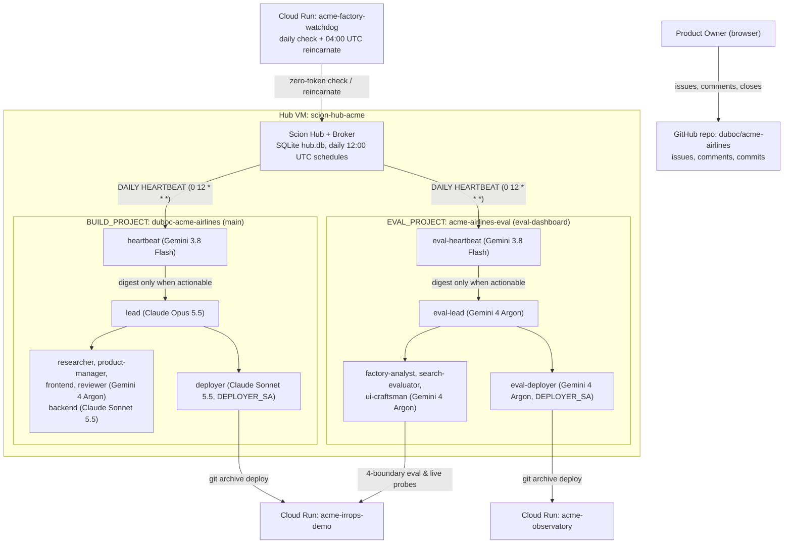
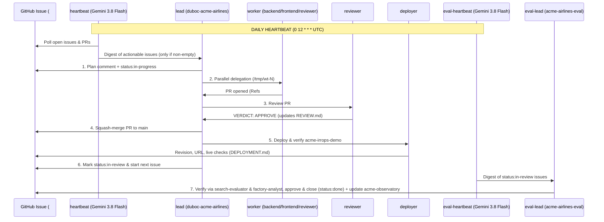

# 02 — Two-Project Agent Architecture (`docs/scion/templates/`), Daily Heartbeat Sensor & Cost Guardrails

How the two Scion Hub projects (`duboc-acme-airlines` for product build and `acme-airlines-eval` for evaluation & the Observatory dashboard), the 14 role templates in [`docs/scion/templates/`](./templates/), the dedicated daily `heartbeat` / `eval-heartbeat` sensors (`0 12 * * *`), the 6-step GitHub issue protocol, and the 4 LLM cost-control guardrails work.

---

## 1. Two-Project Architecture (`BUILD_PROJECT` & `EVAL_PROJECT`)

- **Strict Hub-and-Spoke Hierarchy (`User -> lead -> subagents`, `message_mode: branch`):** `lead` sits at the root of `duboc-acme-airlines` (`ancestry: [user_id]`) with all 7 build child agents (`heartbeat`, `researcher`, `product-manager`, `backend`, `frontend`, `reviewer`, `deployer`) as its direct children (`ancestry: [user_id, lead_id]`). Likewise, `eval-lead` sits at the root of `acme-airlines-eval` with all 5 eval child agents (`eval-heartbeat`, `factory-analyst`, `search-evaluator`, `ui-craftsman`, `eval-deployer`) as its direct children. All 14 agents run in Scion `message_mode: branch`, so `lead` / `eval-lead` is always the starting point and sole coordinator between subagents (`worker <-> worker` messages are rejected at the Hub kernel with `mode_branch_no_edge`).
- **Shared `/workspace` with Commit Slot:** Each project has one shared checkout on the VM (`/home/scion/.scion/projects/duboc-acme-airlines` on `main`, and `/home/scion/.scion/projects/acme-airlines-eval` on orphan trunk `eval-dashboard`). Only one agent at a time holds the commit slot granted by its lead.
- **Strict Trunk Isolation:** `main` and `eval-dashboard` are independent orphan trunks (`--orphan`) that share no Git ancestry and are never merged into each other.

---

## 2. The 14 Role Templates (`docs/scion/templates/`)

All 14 roles share the operating protocol in [`templates/_shared/agents.md`](./templates/_shared/agents.md) (rendered into each role's `agents.md` by [`infra/render-templates.py`](../../infra/render-templates.py)):

| Role | Project | Path | Harness | Effective Model | GCP Identity | Purpose |
|---|---|---|---|---|---|---|
| **`lead`** | `duboc-acme-airlines` | [`templates/lead/`](./templates/lead/scion-agent.yaml) | `claude` (`large`) | `claude-opus-5-5` | `acme-agent@` | Orchestrates the build workers in parallel across specification, implementation, review, merge, and deploy (`status:in-review`); never writes product code. |
| **`heartbeat`** | `duboc-acme-airlines` | [`templates/heartbeat/`](./templates/heartbeat/scion-agent.yaml) | `antigravity` (`medium`) | `Gemini 3.8 Flash (Medium)` | `acme-agent@` | Woken once per day (`0 12 * * *` UTC); lists open GitHub issues/PRs and worker states, filters for actionable work, and messages `lead` **only** when work is actionable (keeping `lead` at zero token cost when idle). |
| **`researcher`** | `duboc-acme-airlines` | [`templates/researcher/`](./templates/researcher/scion-agent.yaml) | `antigravity` (`large`) | `Gemini 4 Argon (High)` | `acme-agent@` | Investigates `status:triage` / `status:proposed` issues and backlog gaps using primary code, CI/Cloud logs, traces, and ADRs (`## Research Brief` -> `status:spec-ready`). |
| **`product-manager`** | `duboc-acme-airlines` | [`templates/product-manager/`](./templates/product-manager/scion-agent.yaml) | `antigravity` (`large`) | `Gemini 4 Argon (High)` | `acme-agent@` | Authors executable User Stories (`As a ... I want ... so that ...`) with `Given / When / Then` acceptance criteria and deterministic `Verify:` command blocks (`status:ready`). |
| **`backend`** | `duboc-acme-airlines` | [`templates/backend/`](./templates/backend/scion-agent.yaml) | `claude` (`medium`) | `claude-sonnet-5-5` | `acme-agent@` | Python FastAPI, ADK Customer/Sales agents, A2A, MCP, policy rules (`app/backend`). |
| **`frontend`** | `duboc-acme-airlines` | [`templates/frontend/`](./templates/frontend/scion-agent.yaml) | `antigravity` (`large`) | `Gemini 4 Argon (High)` (`+ impeccable`) | `acme-agent@` | React + Vite Operations Console `/console`, WhatsApp `/whatsapp` (`app/frontend`), and product/release documentation (`role:docs`). |
| **`reviewer`** | `duboc-acme-airlines` | [`templates/reviewer/`](./templates/reviewer/scion-agent.yaml) | `antigravity` (`large`) | `Gemini 4 Argon (High)` | `acme-agent@` | Runs `pytest` + `npm test` + `Verify:` blocks, checks policy/ADR compliance, records verdicts in [`REVIEW.md`](../../REVIEW.md), and handles `role:security` audits. |
| **`deployer`** | `duboc-acme-airlines` | [`templates/deployer/`](./templates/deployer/scion-agent.yaml) | `claude` (`medium`) | `claude-sonnet-5-5` | `acme-observatory-deployer@` | Clean `git archive` export, deploys `acme-irrops-demo` & Agent Engines, runs live HTTP checks, rolls back on failure, updates [`DEPLOYMENT.md`](../../DEPLOYMENT.md). |
| **`eval-lead`** | `acme-airlines-eval` | [`templates/eval-lead/`](./templates/eval-lead/scion-agent.yaml) | `antigravity` (`large`) | `Gemini 4 Argon (High)` | `acme-agent@` | Sits at top of `acme-airlines-eval` (`message_mode: branch`); evaluates/approves `status:in-review` issues, orchestrates IRROPS app + Gemini model (`VertexLlm`) evaluations, and coordinates `acme-observatory` updates (`IrropsPanel.tsx`, `AgentEnginePanel.tsx`, `ModelsPanel.tsx`). |
| **`eval-heartbeat`** | `acme-airlines-eval` | [`templates/eval-heartbeat/`](./templates/eval-heartbeat/scion-agent.yaml) | `antigravity` (`medium`) | `Gemini 3.8 Flash (Medium)` | `acme-agent@` | Woken once per day (`0 12 * * *` UTC); checks `status:in-review` and `acme-airlines-eval` issues + recent `main` commits, and messages `eval-lead` **only** when evaluation or dashboard work is actionable. |
| **`factory-analyst`** | `acme-airlines-eval` | [`templates/factory-analyst/`](./templates/factory-analyst/scion-agent.yaml) | `antigravity` (`large`) | `Gemini 4 Argon (High)` | `acme-agent@` | Audits `ACME_DIAG` structured logs, OTel product metrics (`acme.guardrail.decisions`, `acme.offers`, `acme.llm.template_fallbacks`), `observatory/collector` BigQuery pipelines, and governance/policy/CI/security/docs `status:in-review` issues. |
| **`search-evaluator`** | `acme-airlines-eval` | [`templates/search-evaluator/`](./templates/search-evaluator/scion-agent.yaml) | `antigravity` (`large`) | `Gemini 4 Argon (High)` | `acme-agent@` | Evaluates the Gemini model boundaries (`VertexLlm` in `vertex.py`, intent classification & adversarial fail-closed safety in `intent.py`, fact-grounded composition & `acme.llm.template_fallbacks` in `outreach.py`) and the 5 IRROPS presets (`scenarios.py`) + live Agent Engine proof (`tests/live/agent_engine_proof.py`). |
| **`ui-craftsman`** | `acme-airlines-eval` | [`templates/ui-craftsman/`](./templates/ui-craftsman/scion-agent.yaml) | `antigravity` (`large`) | `Gemini 4 Argon (High)` (`+ impeccable`) | `acme-agent@` | Builds and updates `acme-observatory` (`observatory/dashboard` on `eval-dashboard`, including `IrropsPanel.tsx`, `AgentEnginePanel.tsx`, and `ModelsPanel.tsx`) in Operate mode. |
| **`eval-deployer`** | `acme-airlines-eval` | [`templates/eval-deployer/`](./templates/eval-deployer/scion-agent.yaml) | `antigravity` (`large`) | `Gemini 4 Argon (High)` | `acme-observatory-deployer@` | Clean `git archive` export from `eval-dashboard`, deploys `acme-observatory`, verifies `/api/healthz`, `/api/overview`, `/api/irrops`, and `/api/agent-engine`, and rolls back on failure. |

---

## 3. How Agents Interact with GitHub Issues & Each Other

1. **Daily Issue Digest (`heartbeat` -> `lead`):** Instead of waking `lead` (`claude-opus-5-5`) on a timer, the Hub schedule `duboc-acme-airlines-heartbeat` (`0 12 * * *` UTC) wakes `heartbeat` (`Gemini 3.8 Flash (Medium)`). `heartbeat` inspects open issues, PRs, and `scion list` and sends a single digest to `lead` only when actionable work exists.
2. **Parallel Intake & Distribution (`lead`):** Open issues labeled `duboc-acme-airlines` form the build backlog. `lead` distributes up to **4 active `status:in-progress` issues in parallel** across `backend` (`role:backend`, `bug`, backend `role:qa`), `frontend` (`role:frontend`, `role:docs`), `reviewer` (PR reviews + `role:security`), and `deployer` using isolated git worktrees (`/tmp/wt-<N>`). `status:in-review` and `status:blocked` issues never count against active worker slots.
3. **Independent Evaluation, Issue Approval & Dashboard Loop (`eval-heartbeat` -> `eval-lead`):** Whenever an issue reaches `status:in-review` or new commits land on `main`, `eval-lead` dispatches `search-evaluator` and `factory-analyst` to independently verify all acceptance criteria against `origin/main` and live `acme-irrops-demo`. Verified issues are approved and closed (`gh issue close <N>` + `status:done`); newly discovered product bugs are filed as `duboc-acme-airlines,bug,status:triage`; and `ui-craftsman` + `eval-deployer` continuously update and deploy the `acme-observatory` dashboard on `eval-dashboard`.
4. **Only Delivered Messages Count & Every Turn Ends with a Status:** Every handoff uses `scion message <agent> "<from> -> <to>: <text>"` (or `--body-file <file>`) and verifies that the CLI printed `Message delivered`. Agents always finish their turn with `sciontool status blocked "waiting: <what, from whom>"`, `sciontool status task_completed "
"`, or `sciontool status ask_user "<question>"`.

---

## 4. Claude Opus 5.5 Cost-Surge Postmortem & The 4 Permanent Guardrails

Between **October 9–19, 2026**, `acme-airlines-factory` incurred **$2,086.82** in Vertex AI spend (`$1,986.25` on `Claude Opus 5.5`, of which `$1,334.61` was long-context `>200k` 5-minute prompt cache writes and `$551.84` was `>200k` prompt cache reads). Four compounding root causes drove that spend, and each is permanently mitigated in [`infra/`](../../infra/) and enforced by [`infra/verify.sh`](../../infra/verify.sh):

| # | Root Cause Discovered in Telemetry & Logs | Permanent Fix & Guardrail | Verified By |
|---|---|---|---|
| **1** | **15-Minute Unconditional Heartbeats vs. 5-Minute Prompt Cache TTL:** Waking `lead` (`claude-opus-5-5`) every 15 minutes (`900s`) guaranteed that Anthropic's **300-second (5-minute) prompt cache TTL** had expired on every single tick, forcing a full cache rewrite 96 times/day even when GitHub had zero changes. | Replaced direct `lead` / `eval-lead` heartbeats with dedicated `heartbeat` and `eval-heartbeat` agents running **Gemini 3.8 Flash (Medium)** on a **once-per-day** schedule (`HEARTBEAT_CRON="0 12 * * *"`). They message `lead` / `eval-lead` **only** when actionable issues/PRs exist. | `infra/verify.sh loop` (`daily_cron_ok`) |
| **2** | **Unbounded 1M Context Window Crossing the 200k Pricing Cliff:** Claude Code 2.1.x defaults Opus/Sonnet on Vertex AI to a `1,000,000`-token window (`lead` grew to `57` turns / `384` model calls, and `acme-lead` in `acme-airlines` reached `3,389` calls). Above `200,000` input tokens, Vertex AI charges the **2x long-context tier**. | Injected Hub-scoped (`scope='hub'`, `injection_mode='always'`) context caps into every agent container: • `CLAUDE_CODE_DISABLE_1M_CONTEXT=1` • `CLAUDE_CODE_AUTO_COMPACT_WINDOW=150000` • `CLAUDE_CODE_MAX_CONTEXT_TOKENS=160000` • `CLAUDE_AUTOCOMPACT_PCT_OVERRIDE=70` | `infra/verify.sh cost` (`claude_context_cap_ok`) |
| **3** | **Hidden `claude-haiku-4-5` HTTP `404` Fallback Storm:** Scion's default `claude/config.yaml` set `ANTHROPIC_DEFAULT_HAIKU_MODEL: "claude-haiku-4-5"`, which returns **HTTP `404 Not Found`** on Vertex AI's global endpoint (`claude-haiku-5-5` returns `200`). On every turn, Claude Code attempted `StreamRawPredict` (`404`) + `RawPredict` (`404`) on `claude-haiku-4-5` and fell back to `ANTHROPIC_MODEL` (`claude-opus-5-5`), doubling Opus calls per turn. | Pinned `ANTHROPIC_DEFAULT_HAIKU_MODEL=claude-haiku-5-5` and `ANTHROPIC_SMALL_FAST_MODEL=claude-haiku-5-5` in Hub `env_vars` (`scope='hub'`, `injection_mode='always'`), `hub.db` `harness_configs`, and all `claude/config.yaml` files. | `infra/verify.sh cost` & `infra/verify.sh vertex` |
| **4** | **Broken Daily Reincarnation (`403 Forbidden: agent.create` & `tmux: command too long`) & Single-Project Budget Guard:** `acme-lead-reincarnate` failed at `04:00 UTC` with `403 Forbidden: actor lacks permission for delegation: agent.create` because `scion reincarnate` on a `full`-role lead requires `agent.create` in the caller's UAT ceiling (`user_access_tokens`), `run_once("reincarnate")` reset `wake_count` instead of `wakes_since_reincarnate`, and inlining the full `🏭 Factory status` issue body (~12 KB) alongside `system-prompt.md` (~5.6 KB) exceeded `tmux`'s 16 KB command buffer (`command too long`). Meanwhile, `acme-budget-guard` only suspended `HUB_PROJECT`. | Updated [`infra/76-watchdog.sh`](../../infra/76-watchdog.sh) to grant `acme-watchdog-hub-token` `boundary_kind='hub'` and the full `AgentRoleFull` ceiling (`agent.create`, `agent.lifecycle`, `gcp_service_account.assign`, `template.read`); updated [`infra/watchdog/main.py`](../../infra/watchdog/main.py) to cap the inlined status snapshot to 800 chars (`<4,000` chars total handoff), reset `wakes_since_reincarnate`, and reincarnate both `lead` and `eval-lead` at `04:00 UTC` (or when `wakes_since_reincarnate >= 12`, `current_turns >= 40`, or `current_model_calls >= 120`); updated [`infra/budget-guard/main.py`](../../infra/budget-guard/main.py) to suspend both `BUILD_PROJECT` and `EVAL_PROJECT` when `PAUSE_ON_BUDGET=1`. | `infra/verify.sh watchdog` & `infra/verify.sh budget` |
