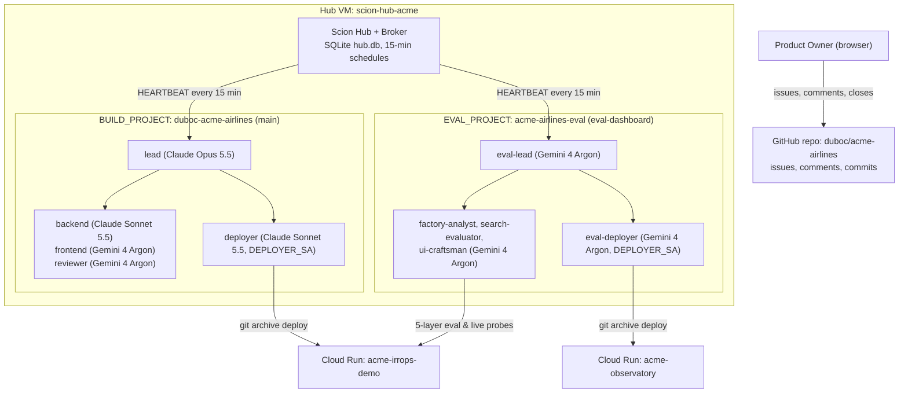
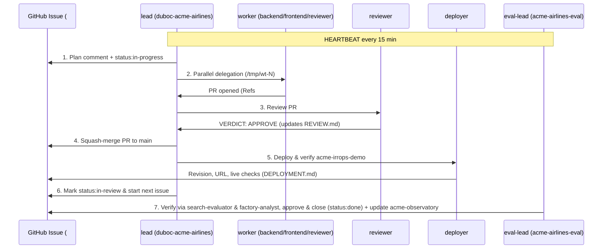

# 02 — Two-Project Agent Architecture (`docs/scion/templates/`), 15-Minute Heartbeat & Issue Protocol

How the two Scion Hub projects (`duboc-acme-airlines` for product build and `acme-airlines-eval` for evaluation & the Observatory dashboard), the 10 role templates in [`docs/scion/templates/`](./templates/), the 15-minute `HEARTBEAT`, and the 6-step GitHub issue protocol work — matching [`duboc/scion-experiment`](https://github.com/duboc/scion-experiment).

---

## 1. Two-Project Architecture (`BUILD_PROJECT` & `EVAL_PROJECT`)

- **Strict Hub-and-Spoke Hierarchy (`User -> lead -> subagents`, `message_mode: branch`):** `lead` sits at the root of `duboc-acme-airlines` (`ancestry: [user_id]`) with all 6 build subagents (`researcher`, `product-manager`, `backend`, `frontend`, `reviewer`, `deployer`) as its direct children (`ancestry: [user_id, lead_id]`). Likewise, `eval-lead` sits at the root of `acme-airlines-eval` with all 4 eval subagents (`factory-analyst`, `search-evaluator`, `ui-craftsman`, `eval-deployer`) as its direct children. All 12 agents run in Scion `message_mode: branch`, so `lead` / `eval-lead` is always the starting point and sole coordinator between subagents (`worker <-> worker` messages are rejected at the Hub kernel with `mode_branch_no_edge`).
- **Shared `/workspace` with Commit Slot:** Each project has one shared checkout on the VM (`/home/scion/.scion/projects/duboc-acme-airlines` on `main`, and `/home/scion/.scion/projects/acme-airlines-eval` on orphan trunk `eval-dashboard`). Only one agent at a time holds the commit slot granted by its lead.
- **Strict Trunk Isolation:** `main` and `eval-dashboard` are independent orphan trunks (`--orphan`) that share no Git ancestry and are never merged into each other.

---

## 2. The 12 Role Templates (`docs/scion/templates/`)

All 12 roles share the operating protocol in [`templates/_shared/agents.md`](./templates/_shared/agents.md) (rendered into each role's `agents.md` by [`infra/render-templates.py`](../../infra/render-templates.py)):

| Role | Project | Path | Harness | Effective Model | GCP Identity | Purpose |
|---|---|---|---|---|---|---|
| **`lead`** | `duboc-acme-airlines` | [`templates/lead/`](./templates/lead/scion-agent.yaml) | `claude` (`large`) | `claude-opus-5-5` | `acme-agent@` | Orchestrates the 6 build workers in parallel across specification, implementation, review, merge, and deploy (`status:in-review`); never writes product code. |
| **`researcher`** | `duboc-acme-airlines` | [`templates/researcher/`](./templates/researcher/scion-agent.yaml) | `antigravity` (`large`) | `Gemini 4 Argon (High)` | `acme-agent@` | Investigates `status:triage` / `status:proposed` issues and backlog gaps using primary code, CI/Cloud logs, traces, and ADRs (`## Research Brief` -> `status:spec-ready`). |
| **`product-manager`** | `duboc-acme-airlines` | [`templates/product-manager/`](./templates/product-manager/scion-agent.yaml) | `antigravity` (`large`) | `Gemini 4 Argon (High)` | `acme-agent@` | Authors executable User Stories (`As a ... I want ... so that ...`) with `Given / When / Then` acceptance criteria and deterministic `Verify:` command blocks (`status:ready`). |
| **`backend`** | `duboc-acme-airlines` | [`templates/backend/`](./templates/backend/scion-agent.yaml) | `claude` (`medium`) | `claude-sonnet-5-5` | `acme-agent@` | Python FastAPI, ADK Customer/Sales agents, A2A, MCP, policy rules (`app/backend`). |
| **`frontend`** | `duboc-acme-airlines` | [`templates/frontend/`](./templates/frontend/scion-agent.yaml) | `antigravity` (`large`) | `Gemini 4 Argon (High)` (`+ impeccable`) | `acme-agent@` | React + Vite Operations Console `/console`, WhatsApp `/whatsapp` (`app/frontend`), and product/release documentation (`role:docs`). |
| **`reviewer`** | `duboc-acme-airlines` | [`templates/reviewer/`](./templates/reviewer/scion-agent.yaml) | `antigravity` (`large`) | `Gemini 4 Argon (High)` | `acme-agent@` | Runs `pytest` + `npm test` + `Verify:` blocks, checks policy/ADR compliance, records verdicts in [`REVIEW.md`](../../REVIEW.md), and handles `role:security` audits. |
| **`deployer`** | `duboc-acme-airlines` | [`templates/deployer/`](./templates/deployer/scion-agent.yaml) | `claude` (`medium`) | `claude-sonnet-5-5` | `acme-observatory-deployer@` | Clean `git archive` export, deploys `acme-irrops-demo` & Agent Engines, runs live HTTP checks, rolls back on failure, updates [`DEPLOYMENT.md`](../../DEPLOYMENT.md). |
| **`eval-lead`** | `acme-airlines-eval` | [`templates/eval-lead/`](./templates/eval-lead/scion-agent.yaml) | `antigravity` (`large`) | `Gemini 4 Argon (High)` | `acme-agent@` | Sits at top of `acme-airlines-eval` (`message_mode: branch`); evaluates/approves `status:in-review` issues, orchestrates IRROPS app + Gemini model (`VertexLlm`) evaluations, and coordinates `acme-observatory` updates (`IrropsPanel.tsx`, `AgentEnginePanel.tsx`, `ModelsPanel.tsx`). |
| **`factory-analyst`** | `acme-airlines-eval` | [`templates/factory-analyst/`](./templates/factory-analyst/scion-agent.yaml) | `antigravity` (`large`) | `Gemini 4 Argon (High)` | `acme-agent@` | Audits `ACME_DIAG` structured logs, OTel product metrics (`acme.guardrail.decisions`, `acme.offers`, `acme.llm.template_fallbacks`), `observatory/collector` BigQuery pipelines, and governance/policy/CI/security/docs `status:in-review` issues. |
| **`search-evaluator`** | `acme-airlines-eval` | [`templates/search-evaluator/`](./templates/search-evaluator/scion-agent.yaml) | `antigravity` (`large`) | `Gemini 4 Argon (High)` | `acme-agent@` | Evaluates the Gemini model boundaries (`VertexLlm` in `vertex.py`, intent classification & adversarial fail-closed safety in `intent.py`, fact-grounded composition & `acme.llm.template_fallbacks` in `outreach.py`) and the 5 IRROPS presets (`scenarios.py`) + live Agent Engine proof (`tests/live/agent_engine_proof.py`). |
| **`ui-craftsman`** | `acme-airlines-eval` | [`templates/ui-craftsman/`](./templates/ui-craftsman/scion-agent.yaml) | `antigravity` (`large`) | `Gemini 4 Argon (High)` (`+ impeccable`) | `acme-agent@` | Builds and updates `acme-observatory` (`observatory/dashboard` on `eval-dashboard`, including `IrropsPanel.tsx`, `AgentEnginePanel.tsx`, and `ModelsPanel.tsx`) in Operate mode. |
| **`eval-deployer`** | `acme-airlines-eval` | [`templates/eval-deployer/`](./templates/eval-deployer/scion-agent.yaml) | `antigravity` (`large`) | `Gemini 4 Argon (High)` | `acme-observatory-deployer@` | Clean `git archive` export from `eval-dashboard`, deploys `acme-observatory`, verifies `/api/healthz`, `/api/overview`, `/api/irrops`, and `/api/agent-engine`, and rolls back on failure. |

---

## 3. How Agents Interact with GitHub Issues & Each Other

1. **Parallel Intake & Distribution (`lead`):** Open issues labeled `duboc-acme-airlines` form the build backlog. `lead` distributes up to **4 active `status:in-progress` issues in parallel** across `backend` (`role:backend`, `bug`, backend `role:qa`), `frontend` (`role:frontend`, `role:docs`), `reviewer` (PR reviews + `role:security`), and `deployer` using isolated git worktrees (`/tmp/wt-<N>`). `status:in-review` and `status:blocked` issues never count against active worker slots.
2. **Independent Evaluation, Issue Approval & Dashboard Loop (`eval-lead`):** Whenever an issue reaches `status:in-review` or new commits land on `main`, `eval-lead` dispatches `search-evaluator` and `factory-analyst` to independently verify all acceptance criteria against `origin/main` and live `acme-irrops-demo`. Verified issues are approved and closed (`gh issue close <N>` + `status:done`); newly discovered product bugs are filed as `duboc-acme-airlines,bug,status:triage`; and `ui-craftsman` + `eval-deployer` continuously update and deploy the `acme-observatory` dashboard on `eval-dashboard`.
3. **Only Delivered Messages Count:** Every handoff uses `scion message <agent> "<from> -> <to>: <text>"` (or `--body-file <file>`) and verifies that the CLI printed `Message delivered`.
4. **Every Turn Ends with a Status & Narrow Escalation:** Agents always finish their turn with `sciontool status blocked "waiting: <what, from whom>"`, `sciontool status task_completed "
"`, or `sciontool status ask_user "<question>"`. Leads only escalate to `user:<PO_EMAIL>` after two failed recovery attempts on a genuine external IAM or scope blocker.

---

## 4. The 15-Minute Heartbeat (`infra/heartbeat-message.txt`) & Safety Guardrails

- **15-Minute Hub Heartbeat Schedules (`*/15 * * * *`):**
  - `duboc-acme-airlines-lead-heartbeat` → messages `lead` in `duboc-acme-airlines`
  - `acme-airlines-eval-lead-heartbeat` → messages `eval-lead` in `acme-airlines-eval`
  - Prompt ([`infra/heartbeat-message.txt`](../../infra/heartbeat-message.txt)):
    > `HEARTBEAT (every 15 min): 1) run scion list and read the messages you received since your last turn; 2) check the open issues of your project: gh issue list -R duboc/acme-airlines --state open --label <your project slug> --limit 30; 3) if an agent you are waiting on has been silent for more than 30 minutes, ping it with scion message (check that it prints Message delivered) or proceed without it; don't ping agents you aren't waiting on; 4) continue the next step of the open work; 5) before ending your turn, run sciontool status blocked "waiting: <what>". If nothing needs action, do only step 5.`
- **Watchdog & `$2,000` Budget Visibility Safety Net:**
  - Standing agents run without artificial `max_duration`, `max_turns`, or `max_model_calls` limits so multi-step sessions and handoffs never stall at `limits_exceeded`.
  - `acme-factory-watchdog` (`0 * * * *`) + `acme-lead-reincarnate` (`0 4 * * *`) provide external self-healing and Cloud Monitoring email alerts; the `$2,000` Cloud Billing budget (`50%`, `90%`, `100%`) + `acme-budget-guard` (`PAUSE_ON_BUDGET=0` default) provide spend visibility without stopping the Hub VM or interrupting running agents.
  - `bash infra/60-factory.sh status | pause | resume` controls both projects' heartbeats and agents without stopping the Hub VM.
