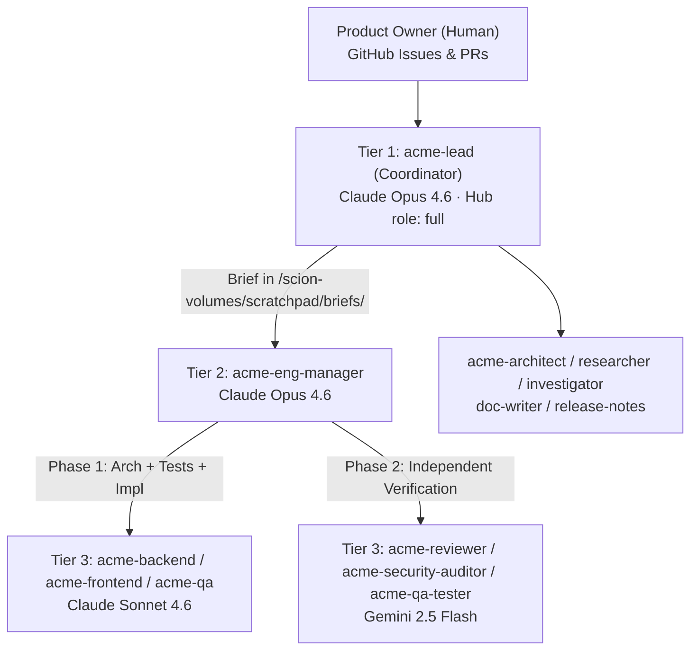

# 02 — Agent Team (`scion-frontiers/agent-team`) & Heartbeat Configuration

How the 13 factory agents are built from [`scion-frontiers/agent-team`](https://github.com/scion-frontiers/agent-team), organized into a 3-tier hierarchy, and kept running via the 4-layer heartbeat.

---

## 1. How Templates Are Built from `scion-frontiers/agent-team`

Our templates follow the exact upstream [`scion-frontiers/agent-team`](https://github.com/scion-frontiers/agent-team) (`3650f1b`) pattern:

1. **Repository instructions live in [`AGENTS.md`](../../AGENTS.md) and [`CLAUDE.md`](../../CLAUDE.md):**
   Upstream `agent-team` templates instruct every agent to read `CLAUDE.md` / `AGENTS.md` in `/workspace` for build/test commands (`uv run pytest`, `npm test`), product guardrails ("Two Goals, One Guardrail"), and PR rules (`<= 400` diff lines, `VERDICT: APPROVE`).
2. **Compact factory naming overlay ([`factory/team/team-rules.md`](../../factory/team/team-rules.md) + [`factory/team/roles/lead.md`](../../factory/team/roles/lead.md)):**
   Maps upstream role names (`coordinator`, `eng-manager`, `developer`, `code-reviewer`, `test-engineer`) to our standing agent names (`acme-lead`, `acme-eng-manager`, `acme-backend`, `acme-frontend`, `acme-reviewer`, `acme-qa`) and `/scion-volumes/scratchpad/` paths.
3. **Template generator ([`infra/40-build-team-templates.sh`](../../infra/40-build-team-templates.sh)):**
   Combines the compact header with upstream `templates/<upstream>/{agents.md,system-prompt.md,scion-agent.yaml}`, pins skill URIs (`gh://scion-frontiers/agent-team/skills/...@3650f1b...`), and applies model & turn/duration caps into `factory/templates/acme-*/`.

```bash
# Rebuild all 13 templates and push to the Scion Hub
bash infra/40-build-team-templates.sh
bash infra/45-push-templates.sh
```

---

## 2. The 13 Standing Agents, Models & Caps

| Agent Name | Upstream Template | Harness | Model | Max Duration | Max Turns | Max Model Calls |
|---|---|---|---|---|---|---|
| `acme-lead` | `coordinator` | `claude` | `claude-opus-4-6` | *(long-lived)* | — | — |
| `acme-eng-manager` | `eng-manager` | `claude` | `claude-opus-4-6` | `3h` | `100` | `200` |
| `acme-architect` | `architect` | `claude` | `claude-opus-4-6` | `2h` | `60` | `120` |
| `acme-backend` | `developer` | `claude` | `claude-sonnet-4-6` | `2h` | `80` | `160` |
| `acme-frontend` | `developer` | `claude` | `claude-sonnet-4-6` | `2h` | `80` | `160` |
| `acme-qa` | `test-engineer` | `claude` | `claude-sonnet-4-6` | `2h` | `80` | `160` |
| `acme-reviewer` | `code-reviewer` | `antigravity` | `gemini-2.5-flash` | `45m` | — | `60` |
| `acme-security-auditor` | `security-auditor` | `antigravity` | `gemini-2.5-flash` | `45m` | — | `60` |
| `acme-qa-tester` | `qa-tester` | `antigravity` | `gemini-2.5-flash` | `45m` | — | `60` |
| `acme-investigator` | `investigator` | `antigravity` | `gemini-2.5-flash` | `45m` | — | `60` |
| `acme-researcher` | `researcher` | `antigravity` | `gemini-2.5-flash` | `45m` | — | `60` |
| `acme-doc-writer` | `doc-writer` | `antigravity` | `gemini-2.5-flash` | `45m` | — | `60` |
| `acme-release-notes` | `release-notes` | `antigravity` | `gemini-2.5-flash` | `45m` | — | `60` |

---

## 3. Agent Hierarchy & Shared Scratchpad (`/scion-volumes/scratchpad`)



- **Hub Lineage:** All 12 worker agents are seeded by [`infra/50-seed-team.sh`](../../infra/50-seed-team.sh) with `created_by = agent:<acme-lead-uuid>` so `acme-lead` (`role: full`) can wake, suspend, or inspect them while workers run with `role: baseline`.
- **State Continuity (`agent-state-continuity` + `artifact-durability`):**
  - `acme-lead` persists `/scion-volumes/scratchpad/coordinator-state.md` and updates pinned GitHub Issue `#2`.
  - `acme-eng-manager` persists `/scion-volumes/scratchpad/em-state-<epic>.md` and reads briefs from `/scion-volumes/scratchpad/briefs/issue-<N>.md`.

---

## 4. The 4-Layer Heartbeat & Cost Guardrails

| Layer | Mechanism | Cadence | What It Does |
|---|---|---|---|
| **1. Event-Driven** | `scion message acme-lead "..."` | Immediate | Workers message `acme-lead` (or `acme-eng-manager`) the moment a PR, review, or epic completes, then run `git status --short` and `scion stop self`. |
| **2. Hourly Watchdog** | `acme-factory-watchdog` ([`infra/76-watchdog.sh`](../../infra/76-watchdog.sh)) | **Every hour (`0 * * * *`)** | Cloud Scheduler → Cloud Run (`POST /check`). Compares a SHA-256 fingerprint of GitHub open issues/PRs/CI + Hub agent phases against `/tmp/watchdog-state.json`. **Zero LLM tokens when nothing changed.** Wakes `acme-lead` at most once/hour (`MIN_WAKE_INTERVAL_SEC=3300`) and auto-recovers stalled/errored `acme-lead` (`STALL_ESCALATE_SEC=3300`). |
| **3. Daily Reincarnation** | `acme-lead-reincarnate` ([`infra/76-watchdog.sh`](../../infra/76-watchdog.sh)) | **Daily `04:00 UTC` (`0 4 * * *`)** | Cloud Scheduler → Cloud Run (`POST /reincarnate`). Stops and restarts `acme-lead` when idle and seeds a fresh session referencing `/scion-volumes/scratchpad/coordinator-state.md` + Issue `#2`, preventing multi-day Opus context bloat. |
| **4. Hub Fallback Tick** | `acme-factory-tick` ([`infra/50-seed-team.sh`](../../infra/50-seed-team.sh)) | **Every 6 hours (`0 */6 * * *`)** | Internal Scion Hub schedule that sends `TICK` to `acme-lead` even if Cloud Run is unreachable. |

### Pause, Resume & `$2,000` Budget Kill-Switch
- **Manual pause / resume** ([`infra/60-factory.sh`](../../infra/60-factory.sh)):
  ```bash
  bash infra/60-factory.sh status   # list agent phases & schedules
  bash infra/60-factory.sh pause    # suspend all 13 agents (never stops the Hub VM)
  bash infra/60-factory.sh resume   # resume acme-lead and send a wake message
  ```
- **Automatic `$2,000` kill-switch** ([`infra/70-budget-guard.sh`](../../infra/70-budget-guard.sh)): Billing threshold alerts at `50% / 80% / 90% / 100%` of `$2,000/month` publish to Pub/Sub `acme-budget-alerts`; at `>= 90%` (`$1,800`), `acme-budget-guard` calls `scion suspend --all` over Direct VPC egress (`STOPPED_BY_BUDGET=true` prevents watchdog wakeups).
