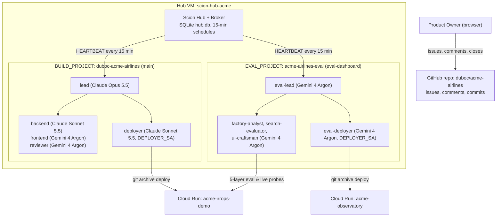
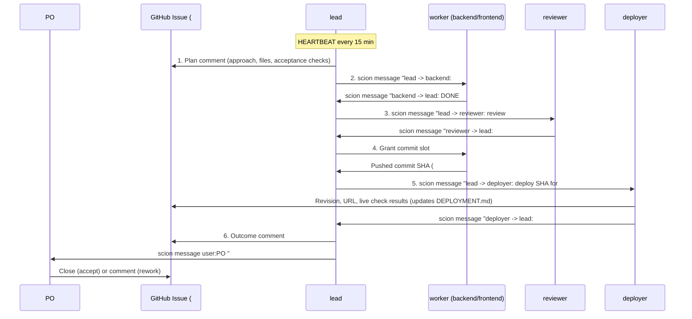

# 02 — Two-Project Agent Architecture (`docs/scion/templates/`), 15-Minute Heartbeat & Issue Protocol

How the two Scion Hub projects (`duboc-acme-airlines` for product build and `acme-airlines-eval` for evaluation & the Observatory dashboard), the 10 role templates in [`docs/scion/templates/`](./templates/), the 15-minute `HEARTBEAT`, and the 6-step GitHub issue protocol work — matching [`duboc/scion-experiment`](https://github.com/duboc/scion-experiment).

---

## 1. Two-Project Architecture (`BUILD_PROJECT` & `EVAL_PROJECT`)

- **Shared `/workspace` with Commit Slot:** Each project has one shared checkout on the VM (`/home/scion/.scion/projects/duboc-acme-airlines` on `main`, and `/home/scion/.scion/projects/acme-airlines-eval` on orphan trunk `eval-dashboard`). Only one agent at a time holds the commit slot granted by its lead.
- **Strict Trunk Isolation:** `main` and `eval-dashboard` are independent orphan trunks (`--orphan`) that share no Git ancestry and are never merged into each other.

---

## 2. The 10 Role Templates (`docs/scion/templates/`)

All 10 roles share the operating protocol in [`templates/_shared/agents.md`](./templates/_shared/agents.md) (rendered into each role's `agents.md` by [`infra/render-templates.py`](../../infra/render-templates.py)):

| Role | Project | Path | Harness | Effective Model | GCP Identity | Purpose |
|---|---|---|---|---|---|---|
| **`lead`** | `duboc-acme-airlines` | [`templates/lead/`](./templates/lead/scion-agent.yaml) | `claude` (`large`) | `claude-opus-5-5` | `acme-agent@` | Plans & delegates build issues in wave order (≤ 2 in flight), reviews diffs, grants commit slot, hands over to PO; never writes product code. |
| **`backend`** | `duboc-acme-airlines` | [`templates/backend/`](./templates/backend/scion-agent.yaml) | `claude` (`medium`) | `claude-sonnet-5-5` | `acme-agent@` | Python FastAPI, ADK Customer/Sales agents, A2A, MCP, policy rules (`app/backend`). |
| **`frontend`** | `duboc-acme-airlines` | [`templates/frontend/`](./templates/frontend/scion-agent.yaml) | `antigravity` (`large`) | `Gemini 4 Argon (High)` (`+ impeccable`) | `acme-agent@` | React + Vite Operations Console `/console` & WhatsApp `/whatsapp` (`app/frontend`). |
| **`reviewer`** | `duboc-acme-airlines` | [`templates/reviewer/`](./templates/reviewer/scion-agent.yaml) | `antigravity` (`large`) | `Gemini 4 Argon (High)` | `acme-agent@` | Runs `pytest` + `npm test`, checks policy/ADR compliance, records verdicts in [`REVIEW.md`](../../REVIEW.md). |
| **`deployer`** | `duboc-acme-airlines` | [`templates/deployer/`](./templates/deployer/scion-agent.yaml) | `claude` (`medium`) | `claude-sonnet-5-5` | `acme-observatory-deployer@` | Clean `git archive` export, deploys `acme-irrops-demo`, runs live HTTP checks, rolls back on failure, updates [`DEPLOYMENT.md`](../../DEPLOYMENT.md). |
| **`eval-lead`** | `acme-airlines-eval` | [`templates/eval-lead/`](./templates/eval-lead/scion-agent.yaml) | `antigravity` (`large`) | `Gemini 4 Argon (High)` | `acme-agent@` | Measures the build factory & live IRROPS service; orchestrates the eval team on `acme-airlines-eval` issues. |
| **`factory-analyst`** | `acme-airlines-eval` | [`templates/factory-analyst/`](./templates/factory-analyst/scion-agent.yaml) | `antigravity` (`large`) | `Gemini 4 Argon (High)` | `acme-agent@` | Analyzes agent activity (`hub.db` / collector snapshots) and GitHub issue flow/bottlenecks from real data only. |
| **`search-evaluator`** | `acme-airlines-eval` | [`templates/search-evaluator/`](./templates/search-evaluator/scion-agent.yaml) | `antigravity` (`large`) | `Gemini 4 Argon (High)` | `acme-agent@` | Runs the 5-layer IRROPS evaluation suite (`acme.evals.runner`) and live scenario/latency probes against `acme-irrops-demo`. |
| **`ui-craftsman`** | `acme-airlines-eval` | [`templates/ui-craftsman/`](./templates/ui-craftsman/scion-agent.yaml) | `antigravity` (`large`) | `Gemini 4 Argon (High)` (`+ impeccable`) | `acme-agent@` | Builds and refines the `acme-observatory` dashboard (`observatory/dashboard`) in Operate mode. |
| **`eval-deployer`** | `acme-airlines-eval` | [`templates/eval-deployer/`](./templates/eval-deployer/scion-agent.yaml) | `antigravity` (`large`) | `Gemini 4 Argon (High)` | `acme-observatory-deployer@` | Clean `git archive` export from `eval-dashboard`, deploys `acme-observatory`, verifies live endpoints, rolls back on failure. |

---

## 3. How Agents Interact with GitHub Issues & Each Other

1. **Intake & Ordering:** Open issues labeled `duboc-acme-airlines` (or `acme-airlines-eval`) and `wave-1`..`wave-5` form the backlog. Each lead works lowest `wave-*` first, then lowest issue number, with **at most 2 issues in flight**.
2. **Only Delivered Messages Count:** Every handoff uses `scion message <agent> "<from> -> <to>: <text>"` (or `--body-file <file>`) and verifies that the CLI printed `Message delivered` (or `Message sent to user:<email>.` for the PO).
3. **Every Turn Ends with a Status:** Agents always finish their turn with `sciontool status blocked "waiting: <what, from whom>"`, `sciontool status task_completed "
"`, or `sciontool status ask_user "<question>"`.
4. **Narrow Escalation & PO Acceptance:** Leads escalate to `user:<PO_EMAIL>` only for IAM grants, cost/paid resources, or scope questions. Leads never close issues themselves — **the PO accepts work by closing the issue**.

---

## 4. The 15-Minute Heartbeat (`infra/heartbeat-message.txt`) & Safety Guardrails

- **15-Minute Hub Heartbeat Schedules (`*/15 * * * *`):**
  - `duboc-acme-airlines-lead-heartbeat` → messages `lead` in `duboc-acme-airlines`
  - `acme-airlines-eval-lead-heartbeat` → messages `eval-lead` in `acme-airlines-eval`
  - Prompt ([`infra/heartbeat-message.txt`](../../infra/heartbeat-message.txt)):
    > `HEARTBEAT (every 15 min): 1) run scion list and read the messages you received since your last turn; 2) check the open issues of your project: gh issue list -R duboc/acme-airlines --state open --label <your project slug> --limit 30; 3) if an agent you are waiting on has been silent for more than 30 minutes, ping it with scion message (check that it prints Message delivered) or proceed without it; don't ping agents you aren't waiting on; 4) continue the next step of the open work; 5) before ending your turn, run sciontool status blocked "waiting: <what>". If nothing needs action, do only step 5.`
- **Watchdog & `$2,000` Budget Visibility Safety Net:**
  - Standing agents run without artificial `max_duration`, `max_turns`, or `max_model_calls` limits so multi-step sessions and handoffs never stall at `limits_exceeded`.
  - `acme-factory-watchdog` (`0 * * * *`) + `acme-lead-reincarnate` (`0 4 * * *`) provide external self-healing and Cloud Monitoring email alerts; the `$2,000` Cloud Billing budget (`50%`, `90%`, `100%`) + `acme-budget-guard` (`PAUSE_ON_BUDGET=0` default) provide spend visibility without stopping the Hub VM or interrupting running agents.
  - `bash infra/60-factory.sh status | pause | resume` controls both projects' heartbeats and agents without stopping the Hub VM.
