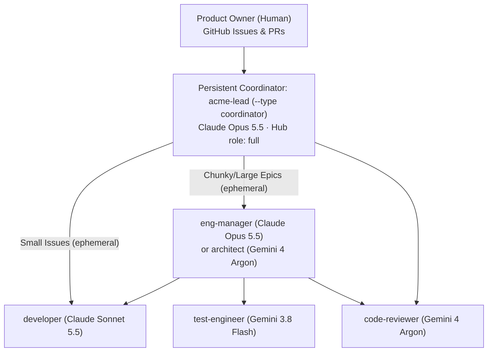

# 02 — Agent Team (`docs/scion/templates/`) & Heartbeat Configuration

How the 6 core [`scion-frontiers/agent-team`](https://github.com/scion-frontiers/agent-team) templates in [`docs/scion/templates/`](./templates/) are imported and synced via the `scion` CLI, mapped to `gemini-4-argon`, `gemini-3.8-flash`, `claude-opus-5-5`, and `claude-sonnet-5-5`, and kept running via the 4-layer heartbeat with zero idle agent sprawl.

---

## 1. Harness `model_aliases` (`infra/setup-scion.sh`)

[`infra/setup-scion.sh`](../../infra/setup-scion.sh) upgrades `scion-antigravity:latest` to `agy 1.3.4` and syncs `model_aliases` across all harnesses on the Hub via `scion --global harness-config sync <name>`:

| Harness | `large` / `extra-large` | `medium` | `small` |
|---|---|---|---|
| **`claude`** (`2.1.295`) | `claude-opus-5-5` | `claude-sonnet-5-5` | `claude-haiku-5-5` |
| **`antigravity`** (`agy 1.3.4`) | `Gemini 4 Argon (High)` (`gemini-4-argon`) | `Gemini 3.8 Flash (Medium)` (`gemini-3.8-flash`) | `Gemini 3.1 Flash Lite` |
| **`gemini-cli`** | `gemini-4-argon` | `gemini-3.8-flash` | `gemini-3.5-flash-lite` |

---

## 2. The 6 Agent Templates (`docs/scion/templates/`)

Stored directly in [`docs/scion/templates/`](./templates/) and imported + synced to the Hub at global scope by [`infra/setup-scion.sh`](../../infra/setup-scion.sh) (`scion --global templates import --all --force` + `scion --global templates sync --all`):

| Template (`--type`) | Path | Harness | Tier | Effective Model | Max Duration | Max Turns | Max Model Calls |
|---|---|---|---|---|---|---|---|
| **`coordinator`** | [`templates/coordinator/`](./templates/coordinator/scion-agent.yaml) | `claude` | `large` | `claude-opus-5-5` | *(long-lived)* | — | — |
| **`eng-manager`** | [`templates/eng-manager/`](./templates/eng-manager/scion-agent.yaml) | `claude` | `large` | `claude-opus-5-5` | `4h` | `800` | `2400` |
| **`architect`** | [`templates/architect/`](./templates/architect/scion-agent.yaml) | `antigravity` | `large` | `Gemini 4 Argon (High)` (`gemini-4-argon`) | `1h` | `200` | `600` |
| **`developer`** | [`templates/developer/`](./templates/developer/scion-agent.yaml) | `claude` | `medium` | `claude-sonnet-5-5` (+ `impeccable` skill) | `2h` | `400` | `1200` |
| **`code-reviewer`** | [`templates/code-reviewer/`](./templates/code-reviewer/scion-agent.yaml) | `antigravity` | `large` | `Gemini 4 Argon (High)` (`gemini-4-argon`) | `45m` | `150` | `450` |
| **`test-engineer`** | [`templates/test-engineer/`](./templates/test-engineer/scion-agent.yaml) | `antigravity` | `medium` | `Gemini 3.8 Flash (Medium)` (`gemini-3.8-flash`) | `1h` | `200` | `600` |

```bash
# Re-import docs/scion/templates/* and sync harness configs + templates to the Scion Hub
bash infra/setup-scion.sh
```

---

## 3. Zero-Sprawl Hierarchy & Shared Scratchpad (`/scion-volumes/scratchpad`)



- **1 Persistent Coordinator, Ephemeral Workers:** Only **`acme-lead`** (`--type coordinator`) remains persistent on the Hub. Worker agents (`developer`, `code-reviewer`, `test-engineer`, `architect`, `eng-manager`) are spawned on demand (`scion start <slug>-dev --type developer ...`) and **deleted immediately** (`scion delete <name>`) once their PR merges or their review/design completes.
- **State Continuity (`agent-state-continuity` + `artifact-durability`):**
  - `acme-lead` persists `/scion-volumes/scratchpad/projects/duboc-acme-airlines/acme-lead-state.md` and updates pinned GitHub Issue **`🏭 Factory status`**.
  - Task briefs are written to `/scion-volumes/scratchpad/projects/duboc-acme-airlines/briefs/<agent-name>.md`.

---

## 4. The 4-Layer Heartbeat & Cost Guardrails

| Layer | Mechanism | Cadence | What It Does |
|---|---|---|---|
| **1. Event-Driven** | `scion message acme-lead "..."` | Immediate | Workers message `acme-lead` (or their `eng-manager`) the moment a PR, review, or design completes. |
| **2. Hourly Watchdog** | `acme-factory-watchdog` ([`infra/76-watchdog.sh`](../../infra/76-watchdog.sh)) | **Every hour (`0 * * * *`)** | Cloud Scheduler → Cloud Run (`POST /check`). Compares a SHA-256 fingerprint of GitHub open issues/PRs/CI + Hub agent phases. **Zero LLM tokens when nothing changed.** Wakes `acme-lead` at most once/hour (`MIN_WAKE_INTERVAL_SEC=3300`) and auto-recovers stalled/errored `acme-lead` (`STALL_ESCALATE_SEC=3300`). |
| **3. Daily Reincarnation** | `acme-lead-reincarnate` ([`infra/76-watchdog.sh`](../../infra/76-watchdog.sh)) | **Daily `04:00 UTC` (`0 4 * * *`)** | Cloud Scheduler → Cloud Run (`POST /reincarnate`). Stops and restarts `acme-lead` when idle and seeds a fresh session from `"🏭 Factory status"` + `/scion-volumes/scratchpad/`, preventing multi-day Opus context bloat. |
| **4. Hub Fallback Tick** | `acme-factory-tick` ([`infra/60-factory.sh`](../../infra/60-factory.sh)) | **Every 6 hours (`0 */6 * * *`)** | Internal Scion Hub schedule that sends `TICK` to `acme-lead` even if Cloud Run is unreachable. |

### Pause, Resume & `$2,000` Budget Kill-Switch
- **Manual pause / resume** ([`infra/60-factory.sh`](../../infra/60-factory.sh)):
  ```bash
  bash infra/60-factory.sh status   # list agent phases & schedules
  bash infra/60-factory.sh pause    # suspend agents (never stops the Hub VM)
  bash infra/60-factory.sh resume   # resume acme-lead and send a wake message
  ```
- **Automatic `$2,000` kill-switch** ([`infra/70-budget-guard.sh`](../../infra/70-budget-guard.sh)): At `100%` of `$2,000/month`, `acme-budget-guard` calls `scion suspend --all` over Direct VPC egress (`STOPPED_BY_BUDGET=true` prevents watchdog wakeups).
