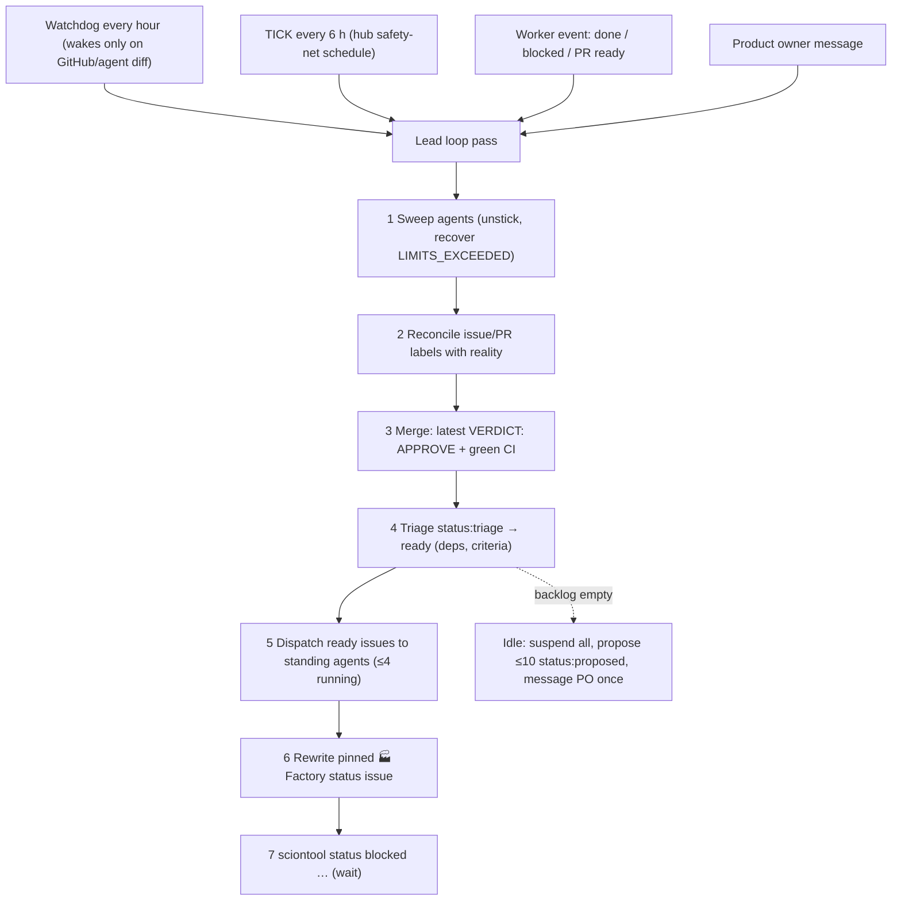

# 4. Operating model: how the factory keeps itself running

## GitHub Issues is the work bus

All task state lives in issues. Chat messages are only notifications.

| Label family | Values |
|---|---|
| status | `status:triage` → `ready` → `in-progress` → `in-review`, plus `blocked`, plus `proposed` (lead suggestion awaiting product-owner approval) |
| owner | `agent:<agent-name>` |
| role | `role:backend` … `role:security` |
| priority | `priority:p0`/`p1`/`p2` |
| area | `area:<workstream>`, e.g. `area:observatory`, `area:agent-engine` |

- **Dependencies:** `Depends on #N` lines in the issue body. Nobody starts an
  issue with open dependencies.
- **Structured comments:** every agent writes
  `[agent] STATUS: … / DONE: … / NEXT: … / BLOCKER: …`, and the next agent
  picks up from the thread.
- **New work found mid-task** becomes a new `status:triage` issue, never scope
  creep in the current PR.
- **Things only a human or operator can do** go in an issue titled
  `needs operator: …` (or `needs product owner`) with `status:blocked`. The
  operator watches for these.

## Merge gate (autonomous)

The lead runs `gh pr merge --squash --delete-branch` when the **latest** review
starts with `VERDICT: APPROVE` **and** `gh pr checks` is green. No human
approval is needed.
- **Red `main`:** a mandatory `priority:p0` fix issue.
- **Security findings:** blocking issues.
- **Reporting:** everything is reported on the status issue, not by DM.

## Backlog policy

| Source | Needs approval? |
|---|---|
| Issues the product owner files | No; they're worked immediately |
| Lead proposals when idle (`status:proposed`, ≤10 open) | **Yes.** The product owner relabels to `status:triage` or comments "approved" |
| Work discovered while delivering approved work (`status:triage`) | No, if it's within the approved scope |

The lead messages the product owner **once** when the backlog is empty. Ticks
are no-ops until something is approved. This keeps the factory "always
cleaning the backlog" without spending tokens on work nobody asked for.

## Keeping it always working

| Failure mode | What handles it |
|---|---|
| A worker stalls or crashes | The lead's sweep: message first ("continue"), recreate under the same name only if that fails |
| A worker hits its cap (`LIMITS_EXCEEDED`) | It commits, pushes and comments state; the lead sends "continue" once, then recreates |
| The lead goes quiet or stalls | `acme-factory-watchdog` (every hour) wakes an idle lead when GitHub/agent state changes, recovers a stopped/errored lead (`scion resume`), and reincarnates a stalled lead on the next hourly check while firing `acme-factory-watchdog-po-alert` to email `ADMIN_EMAIL`. `acme-factory-tick` (`0 */6 * * *`) is the 6-hour safety net |
| Lead context grows over days | `acme-lead-reincarnate` (`0 4 * * *` UTC) reincarnates `acme-lead` daily with a handoff built from `"🏭 Factory status"` |
| A platform permission is missing | Agents file `needs operator`; the operator verifies the diagnosis, grants least privilege, codifies it in `infra/` and `verify.sh`, and closes with evidence |
| `main` is red | p0 fix issue, merged before anything else |
| Spend overrun | The budget guard suspends all agents at 100%; `infra/60-factory.sh resume` restarts |
| A pipeline is silently broken (dashboard shows "empty") | Health checks must cover *data freshness*, not just "service up" (lesson 21) |

## Briefing the team well

- **Product-owner requests:** one **brief issue** per request, with the goal,
  scope, constraints, Given/When/Then acceptance criteria, and a link to a
  **platform contract** doc listing exactly which resources, env vars and
  permissions exist and what agents must *not* change. Examples:
  [`docs/observatory/platform-contract.md`](../observatory/platform-contract.md),
  [`docs/agent-engine/platform-contract.md`](../agent-engine/platform-contract.md).
- **The lead slices the brief** into issues, optionally through an
  eng-manager per workstream.
- **Contracts can be wrong.** When the platform pushes back, fix the contract
  first, then file the code issue. Our Agent Engine contract told agents to
  set reserved `GOOGLE_CLOUD_*` variables.
