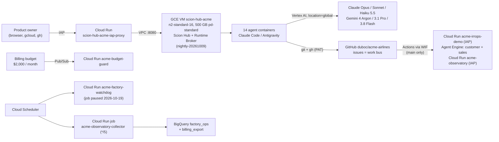
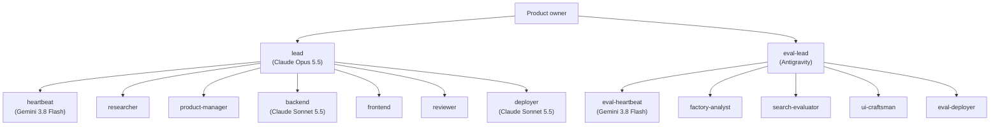
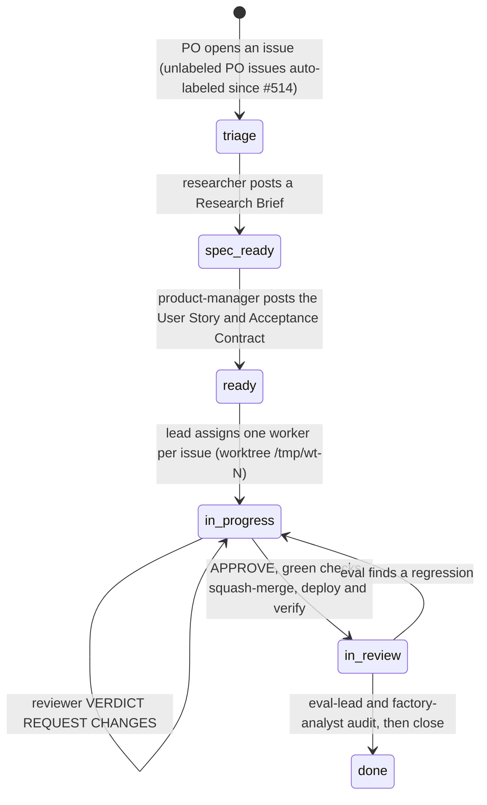

# 04 — Project Record & Decommission Report

> [!IMPORTANT]
> **Status: decommissioned on 2026-11-03.** The product owner (PO) decided to shut the factory down. The GCP project
> `acme-airlines-factory` was deleted at **2026-11-03 20:17 UTC**. It held the Scion Hub VM, Cloud Run, Agent Engine,
> BigQuery, Secret Manager and Artifact Registry. It can be restored until about 2026-12-03, after which the deletion
> is permanent ([§12](#12-decommission-log)). **This repository is kept as the permanent record.** The live URLs in
> the [README](../../README.md) and the [try-it guide](../product/try-it.md) no longer work. Where other docs in this
> repo differ from what actually ran (model aliases, I20; the cost mechanism and idle cost, I21 and I23), this record
> takes precedence.

This document is the single record of what the ACME Airlines software factory was, how it ran, what it produced, what
it cost, what broke, and what it taught. It links to the detailed guides rather than repeating them:
[01 setup](./01-scion-and-gcp-setup.md), [02 agents & heartbeat](./02-agents-and-heartbeat.md),
[03 verification & eval](./03-verification-and-eval.md), [architecture](../product/architecture.md).

**Contents**
1. [At a glance](#1-at-a-glance)
2. [What was built: the product](#2-what-was-built-the-product)
3. [How it was built: the factory](#3-how-it-was-built-the-factory)
4. [Timeline](#4-timeline)
5. [Delivery results](#5-delivery-results)
6. [Cost (measured from the billing export)](#6-cost-measured-from-the-billing-export)
7. [Incidents and fixes](#7-incidents-and-fixes)
8. [Decisions and trade-offs](#8-decisions-and-trade-offs)
9. [Lessons for the next Scion factory](#9-lessons-for-the-next-scion-factory)
10. [Final inventory](#10-final-inventory-what-existed-at-decommission)
11. [Archive](#11-archive-where-everything-was-saved)
12. [Decommission log](#12-decommission-log)
13. [Rebuilding from this repository](#13-rebuilding-from-this-repository)
14. [Appendix: data sources and method](#appendix-data-sources-and-method)

---

## 1. At a glance

| | |
|---|---|
| **What was built** | The ACME Airlines IRROPS demo ([§2](#2-what-was-built-the-product)): a multi-agent airline disruption-recovery app (FastAPI + Google ADK/A2A + React, with optional Vertex AI Agent Engine), plus the `observatory/` evaluation dashboard. |
| **Who built it** | A [Scion](https://github.com/GoogleCloudPlatform/scion) "software factory" of standing LLM agents: about 15 under the lead at the 10-12 peak and 14 at decommission. From 10-14 they ran in two Scion projects on one self-hosted Hub VM. The PO wrote issues and approved scope. |
| **Active period** | 2026-10-09 → 2026-10-23. First PR at 2026-10-09 19:45 UTC. Last product merge at 2026-10-22 16:26 UTC (`f34602c`, #591). Last agent message at 2026-10-23 12:02 UTC. |
| **Idle period** | 2026-10-23 → 2026-11-03. The daily heartbeats ran and found nothing to do. |
| **Issues** | 283 total: 255 completed, 27 not planned. 1 open: #39, the pinned `🏭 Factory status` board. |
| **Pull requests** | 312 total: 285 merged (282 non-Dependabot, 3 Dependabot), 22 closed unmerged, 5 open (Dependabot). Merged diff: **+96,794 / −15,234 lines**. |
| **Speed** | Median time from PR open to merge was **10.8 min** (p90 32.8 min). Peak day was 73 merged PRs (2026-10-15). |
| **Quality gates** | Reviewer verdicts in PR reviews: 248 `VERDICT: APPROVE` and 26 `VERDICT: REQUEST CHANGES` (22 PRs bounced at least once). Required checks: `backend`, `engine-smoke`, `frontend`, `pr-size`. From 10-15, an independent eval audit closed the issues; the 131 issues closed on 10-10 → 10-13 predate the eval project. |
| **Hub activity** | 2,584 agent/PO messages, 1,105 scheduled events (1,100 fired, 5 failed), 22 agent reincarnations, 16 recoveries. |
| **Cost (billing export)** | **$4,084.61 gross / $3,563.57 net** for 2026-10-09 18:00 → 2026-11-02 21:00 UTC. Gross is before credits; net is after −$521.04 of credits, −$464.99 of them on Vertex AI. Claude Opus 5.5 was $2,207.14, 54% of gross. |
| **Largest cost line** | Opus *cache-write* tokens for prompts over 200k tokens: **$1,831.12, 45% of gross**. About $556 of it fell on 10-10 → 10-14 (30-min TICK, I2) and about $1,275 on 10-15 → 10-19 (15-min heartbeats, I1). There was **no unit-price premium** for >200k prompts; the cost was volume (I23). |
| **Idle baseline** | **$20.82/day** gross on complete idle days (10-24 → 10-31). The Hub VM was $19.35/day of that (93%); LLM calls were $0.56/day. |
| **Codebase** | 628 tracked files. Backend: 90 source files (10.4k lines) and 141 test files (18.8k lines). Frontend: 37 files (5.1k lines). Observatory: 97 files (13.4k lines). Infra: 33 files (4.6k lines). Docs: 174 files (44.6k lines). |

---

## 2. What was built: the product

The PO's brief ([`irrops-use-case.md`](../product/irrops-use-case.md), 2026-10-09) asked for **proactive, autonomous
resolution of flight disruptions (IRROPS) plus guardrailed ancillary upselling**. The demo follows Mariana Silva, an
ACME Diamond frequent flyer whose flight AC1234 is cancelled. Her trip is rebuilt before she notices, and a sales
offer can only reach her after her recovery is complete.

| Piece | What it is | Where |
|---|---|---|
| **"Two Goals, One Guardrail"** | Customer recovery and duty of care come first (ANAC Resolution 400, rules `DOC-01`..`DOC-11`). The Sales agent cannot contact passengers, and its offers go through the Customer agent only after resolution. No passenger PII crosses A2A. Policy is validated deterministically. | [`policy-rules.md`](../product/policy-rules.md), [`AGENTS.md`](../../AGENTS.md) |
| **Backend** | FastAPI API + SSE, Google ADK Customer agent with specialists (`irrops` rebooking, `change`, `seat`, `baggage`, `rights`, `duty`, `concierge`), the Sales agent, the deterministic policy engine, the customer-journey state machine, outreach with quiet hours, and simulators. | `app/backend/`, [`architecture.md`](../product/architecture.md) |
| **Frontend** | React + Vite. `/console` is the operator (OCC) view; `/whatsapp` is the simulated passenger chat. | `app/frontend/`, [`PRODUCT.md`](../../PRODUCT.md), [`DESIGN.md`](../../DESIGN.md) |
| **Engines** | Agents run either in the container (`local`) or on **Vertex AI Agent Engine** (`acme-customer-agent`, `acme-sales-agent`), with structural parity checks between the two. | [`engines.md`](../product/engines.md), [ADR 0103](../product/adr-0103-stateless-engine-scenarios.md) |
| **Hosting** | Cloud Run `acme-irrops-demo` behind IAP. Deployed by GitHub Actions through Workload Identity Federation, then verified by the `deployer` agent ([`DEPLOYMENT.md`](../../DEPLOYMENT.md)). | [`deploy.md`](../product/deploy.md) |
| **Telemetry** | OpenTelemetry to Cloud Trace and Monitoring (ADK agent/tool spans and `acme.*` engine spans). | [`architecture.md`](../product/architecture.md#telemetry) |
| **Observatory** | A collector (Cloud Run job, every 5 min) writes to BigQuery `factory_ops`. The `acme-observatory` dashboard was built by the eval project on the orphan `eval-dashboard` trunk. | `observatory/`, branch `eval-dashboard` |
| **Releases** | [v0.1.0](../product/release-notes-v0.1.0.md) and [v0.2.0](../product/release-notes-v0.2.0.md). | `docs/product/` |

---

## 3. How it was built: the factory

**Terms used below**
- **Operator**: the PO's AI-assistant session that ran `gcloud`, `gh` and Hub admin commands.
- **Hub schedule**: a Scion cron that messages an agent. Examples: the TICK, the 15-min heartbeats, the daily heartbeat.
- **Cloud Scheduler job**: a GCP cron that calls Cloud Run. Examples: the watchdog, the reincarnation job, the collector.

### 3.1 Platform

A single VM ran both the Hub and the broker, reached only through the IAP Cloud Run proxy (SSH through IAP). Egress
went through Cloud NAT. Agents used the least-privilege `acme-agent` service account (`assign` identity mode), and
the two deployer roles used `acme-observatory-deployer`. GitHub Actions deployed keyless through the `github` WIF pool,
restricted to `duboc/acme-airlines` on `refs/heads/main`.

### 3.2 Agent topology at decommission (`message_mode: branch`)

The Hub rejects sibling-to-sibling messages (`mode_branch_no_edge`), so every hand-off went through `lead` or
`eval-lead`. The role templates are in [`templates/`](./templates/) and [02](./02-agents-and-heartbeat.md) describes
them.

| Project / trunk | Role | Harness | Configured model | **Model actually running at the end** |
|---|---|---|---|---|
| `duboc-acme-airlines` / `main` | `lead` | Claude Code | `large` → `claude-opus-5-5` | `claude-opus-5-5` |
| | `backend`, `deployer` | Claude Code | `medium` → `claude-sonnet-5-5` | `claude-sonnet-5-5` |
| | `heartbeat` | Antigravity | `medium` → Gemini 3.8 Flash (Medium) | Gemini 3.8 Flash (Medium) |
| | `researcher`, `product-manager`, `frontend`, `reviewer` | Antigravity | `large` → documented as Gemini 4 Argon (High) | **Gemini 3.1 Pro (Low)** from 2026-10-19 19:25 UTC ([§7](#7-incidents-and-fixes), I20) |
| `acme-airlines-eval` / `eval-dashboard` | `eval-heartbeat` | Antigravity | `medium` → Gemini 3.8 Flash (Medium) | Gemini 3.8 Flash (Medium) |
| | `eval-lead`, `factory-analyst`, `search-evaluator`, `ui-craftsman`, `eval-deployer` | Antigravity | `large` → documented as Gemini 4 Argon (High) | **Gemini 3.1 Pro (Low)** from 2026-10-19 19:25 UTC |

**Topology over time**

| Date | Shape |
|---|---|
| 2026-10-09 | `acme-lead` plus 11 standing roles (one project). |
| 2026-10-12 | About 15 agents under the lead, including sub-managers for Agent Engine and the observatory. At least 21 distinct `acme-*` agent names appear across the run, though not all at once. |
| 2026-10-14 | Rebuilt on the `scion-frontiers/agent-team` templates (#289–#291); 12 idle agents deleted. Then the two-project layout: build plus eval with the orphan `eval-dashboard` trunk, 10 agents (#294). |
| 2026-10-15 | 12 agents: spec-driven loop with `researcher` and `product-manager` (#326). Strict `lead` hierarchy and app- and model-specific eval roles (#393). |
| 2026-10-19 | 14 agents: dedicated `heartbeat` and `eval-heartbeat` (#503). |

### 3.3 Work protocol

Gates on every change from 10-13 (admins could still bypass them at decommission):
- A PR with `Refs #N`.
- A reviewer verdict, recorded in [`REVIEW.md`](../../REVIEW.md).
- The required checks.
- The 400-line PR-size gate (`size:exception` label for justified exceptions).
- Branch protection on `main`.
- A deploy record in [`DEPLOYMENT.md`](../../DEPLOYMENT.md).
- A verification tuple on the issue (`merged_sha`, `cloud_run_revision`, verify output).

From 10-15, only the eval project closed issues. Labels drove the state machine: `status:*`, `role:*`, `priority:*`,
`wave-*`, and the project labels. The research and spec stages (`triage` → `ready`) started with #326 on 10-15.

### 3.4 How the factory was woken up

| Period | Mechanism | Effect |
|---|---|---|
| 10-10 → 10-12 | A Hub "TICK" every 30 min woke the Opus lead. | 140 runs, 0 errors (transcript). The full context was rewritten into the prompt cache on every wake; the burn rate was about $13/h on the evening of 10-12. |
| 10-13 | TICK moved to every 6 h. A zero-LLM watchdog (Cloud Scheduler + Cloud Run) ran every 5 min, then hourly (#278). Daily 04:00 lead reincarnation. | Opus cache-write spend fell to $40 (10-13) and $11 (10-14). |
| 10-14 → 10-19 | Two Hub schedules woke `lead` and `eval-lead` every 15 min (#294). | 365 runs each (transcript). Total spend $421–$573/day on 10-15 → 10-19; Opus >200k-prompt cache writes alone were $237–$390/day on 10-16 → 10-19. |
| 10-19 → end | The **dedicated `heartbeat` / `eval-heartbeat` agents on Gemini 3.8 Flash** ran once a day (`0 12 * * *` UTC) and messaged the lead only when there was actionable work (#503). The watchdog cron was set to daily and both Cloud Scheduler jobs were paused (#503, #506). | Opus spend: $304 (10-19) → $10 (10-20) → $0 on idle days. Idle LLM spend was $0.56/day. |

### 3.5 Guardrails in place at the end

| Area | Setting |
|---|---|
| Identity | Agents run as `acme-agent` (`assign` mode) and deployers as `acme-observatory-deployer`. `hub_sa_minting: false`. New web users default to `viewer`. No user-managed SA keys were recorded in the 10-12 audit. |
| Access | IAP on the Hub proxy and both web apps, with a custom OAuth client and an allowlist of Workspace domains (kept out of the tracked config since #292, in gitignored `infra/factory.local.env`). |
| Model and context caps | Hub-scoped env vars (Hub `env_vars` table, set 2026-10-19 18:06 UTC): `CLAUDE_CODE_DISABLE_1M_CONTEXT=1`, `CLAUDE_CODE_AUTO_COMPACT_WINDOW=150000`, `CLAUDE_CODE_MAX_CONTEXT_TOKENS=160000`, `CLAUDE_AUTOCOMPACT_PCT_OVERRIDE=70`, `ANTHROPIC_DEFAULT_HAIKU_MODEL` and `ANTHROPIC_SMALL_FAST_MODEL` = `claude-haiku-5-5`, `GOOGLE_CLOUD_LOCATION=global`. |
| Messaging | `message_mode: branch`. A `/usr/local/bin/scion` shim in every container maps `scion conversation send`, `reply` and `message` to `scion message` (#514). |
| Budget | A $2,000/month budget sent alerts through Pub/Sub to `acme-budget-guard`. It has been **visibility-only** since 2026-10-15 (`PAUSE_ON_BUDGET=0`), at the PO's request. |
| Backups | Daily boot-disk snapshots at 03:00 UTC, kept 7 days (`infra/75-backups.sh`). |
| Supply chain | SHA-pinned Actions (`check_action_pins.py`), Dependabot (weekly, grouped), Trivy and GitGuardian checks, and a mutation-testing gate. |

---

## 4. Timeline

All times are UTC. PR numbers refer to this repo. "(transcript)" marks facts that come only from the operator
transcript.

| When | Milestone |
|---|---|
| 10-09 18:45 | GCP project `acme-airlines-factory` created. Hub VM deployed at 18:56 with Scion `nightly-20261009`. Hub project `duboc-acme-airlines` created at 19:43. First PR at 19:45. The PO's IRROPS brief becomes the backlog. |
| 10-10 | The PO asks for an always-on loop: GitHub Issues as the work bus, autonomous merges, the PO only adds backlog. **75 issues closed and 69 PRs merged in one day.** Budget guard added (suspends agents, never stops the VM). |
| 10-11 | No issues, PRs or messages, yet **$176.62** was spent, 84% of it Opus cache writes from idle 30-min TICKs. |
| 10-12 | IRROPS demo on Cloud Run. Agent Engine epic split. The billing export to BigQuery starts (13:00). Four audit subagents launched (security, best practice, cost, reproducibility); the security reviewer refused (I18). |
| 10-13 | Agent Engine engines `acme-customer-agent` and `acme-sales-agent` created (00:21 and 00:24). Repo made public, with branch protection and required checks. Budget raised from $1,000 to $2,000. Daily snapshots, watchdog, telemetry export and the PR-size gate added (#207, #210). Watchdog moved to hourly (#278). |
| 10-14 | Agents rebuilt on `scion-frontiers/agent-team` (#289–#291). Sensitive values moved to gitignored `factory.local.env`, backed up in Secret Manager (#292). Second Hub project `acme-airlines-eval` created at 21:50 with the orphan `eval-dashboard` trunk. 15-min heartbeats added (#294). |
| 10-15 | All agent limits removed; the budget becomes visibility-only (#302). 12-agent spec-driven loop (#326). Strict `lead` hierarchy and app- and model-specific eval roles (#393). **Peak: 73 PRs merged.** |
| 10-16 | IAP re-applied for the allowed domains; alias-domain fix (#487). **Peak spend: $572.74.** |
| 10-17 → 10-18 | Almost no work (1 message per day), yet **$912.30** was spent, 78% of it Opus cache writes from the 15-min heartbeats. |
| 10-19 | The PO reports the cost spike. Heartbeats slowed to every 6 h as a stopgap. All agents reincarnated; the lead's context fell from 966,454 to 23,644 tokens (transcript). Context caps set at 18:06. #503 (daily Gemini heartbeat agents) merged at 18:20 and #506 (watchdog stays paused) at 18:33. Harness model aliases overwritten at 19:25 (I20). |
| 10-20 | #514 (intake of unlabeled PO issues, `conversation send` shim) merged at 04:51 and #515 (architecture doc, closes #501) at 05:10. The first scheduled daily heartbeat at 12:00 led to 9 merged PRs (#524–#548). |
| 10-21 → 10-22 | Audit-driven fixes: security caps, certifi CVE, e2e timeout, DOC-10/11 strings. Last product merge at 10-22 16:26 (#591). |
| 10-23 12:02 | Last agent message: eval-lead's audit of 12 issues, which were then closed. |
| 10-23 → 11-02 | Idle. Daily heartbeats found nothing to do. Spend ≈ $21/day, almost all of it the VM. |
| 11-03 | The PO asks for full documentation, then decommissioning. Archive and this record produced (#596, 19:49). After the PO confirmed (it was the first time the billing-export finding, I22, was raised), the billing budget was deleted at 20:17:06 and project deletion requested at 20:17:13 ([§12](#12-decommission-log)). |

---

## 5. Delivery results

**Daily activity vs. cost.** The idle days show the cost problem clearly.

| Day | Issues opened | Issues closed | PRs merged | Hub messages | Gross cost |
|---|---:|---:|---:|---:|---:|
| 10-09 | 27 | 0 | 0 | 25 | $16.17 |
| 10-10 | 52 | 75 | 69 | 419 | $354.11 |
| 10-11 | 0 | 0 | 0 | 0 | **$176.62** |
| 10-12 | 24 | 23 | 18 | 178 | $331.38 |
| 10-13 | 40 | 33 | 43 | 258 | $299.62 |
| 10-14 | 1 | 0 | 4 | 34 | $43.28 |
| 10-15 | 54 | 48 | 73 | 842 | $498.96 |
| 10-16 | 28 | 46 | 38 | 413 | $572.74 |
| 10-17 | 0 | 0 | 0 | 1 | **$420.71** |
| 10-18 | 0 | 0 | 0 | 1 | **$491.59** |
| 10-19 | 8 | 7 | 11 | 134 | $424.02 |
| 10-20 | 25 | 13 | 14 | 115 | $111.69 |
| 10-21 | 2 | 10 | 2 | 30 | $32.14 |
| 10-22 | 22 | 15 | 13 | 120 | $89.10 |
| 10-23 | 0 | 12 | 0 | 14 | $22.31 |
| 10-24 → 11-02 | 0 | 0 | 0 | 0 | $200.15 (11-02 is partial) |
| **Total** | **283** | **282** | **285** | **2,584** | **$4,084.61** |

All 283 issues and 290 of the PRs show the author `duboc`, because the agents and the operator used the PO's PAT.
Author counts therefore can't separate PO work from agent work; "non-Dependabot" is the only reliable split.

**CI and deploys.** These are the latest 2,000 of the 2,577 workflow runs, covering 2026-10-13 03:25 onward:

| Workflow | Success | Failure | Cancelled |
|---|---:|---:|---:|
| CI (`backend`, `frontend`, `engine-smoke`, `action-pins`) | 358 | 33 | 124 |
| e2e (Playwright) | 332 | 7 | 42 |
| Containers (build, test, Trivy) | 286 | 33 | 62 |
| PR size | 324 | 3 | 51 |
| IRROPS Demo Deploy (Cloud Run) | 126 | 1 | 16 |
| Agent Engine Deploy | 72 | 0 | 18 |
| Agent Engine Live Proof | 4 | 17 | 0 |
| mutation (nightly) | 23 | 1 | 0 |
| Observatory CI / Deploy | 24 / 5 | 4 / 0 | 1 / 0 |
| Dependabot Updates | 22 | 11 | 0 |

The manual Agent Engine Live Proof passed 4 of the 21 runs in that window. A pass on 10-19 covered 5/5 presets and
17/17 turns (transcript).

**Merged PR size.** Median 149 changed lines, p90 524, and 51 PRs over 400 raw lines:
- 43 merged before the size gate existed (2026-10-13);
- after the gate, 5 carried `size:exception`;
- 3 exceeded 400 raw lines without the label (the gate does not count lockfiles or templates).

---

## 6. Cost (measured from the billing export)

These figures come from the Cloud Billing BigQuery export, filtered to `project.id = acme-airlines-factory`. Coverage
is 2026-10-09 18:00 UTC → 2026-11-02 21:00 UTC. 11-01 and 11-02 are incomplete because of export lag, so roughly
$20–$25 of final spend is missing.

| Invoice month | Gross | Credits | Net |
|---|---:|---:|---:|
| 2026-10 | $4,056.88 | −$519.84 | $3,537.04 |
| 2026-11 (1–2) | $27.73 | −$1.20 | $26.53 |
| **Total** | **$4,084.61** | **−$521.04** | **$3,563.57** |

Invoice months follow Pacific time, so about $5.85 of 11-01 (UTC) is counted in October. The UTC daily rows in [§5](#5-delivery-results) add up to
$4,084.59 because of rounding.

| Service | Gross | Net | Share of gross |
|---|---:|---:|---:|
| Claude Opus 5.5 | $2,207.14 | $2,207.14 | 54.0% |
| Vertex AI (Gemini 4 Argon / 3.1 Pro / 3.8 Flash) | $1,134.94 | $669.95 | 27.8% |
| Compute Engine (Hub VM + disk) | $460.86 | $406.62 | 11.3% |
| Claude Sonnet 5.5 | $245.49 | $245.49 | 6.0% |
| Cloud Run | $27.30 | $27.21 | 0.7% |
| Networking | $7.10 | $5.38 | 0.2% |
| Artifact Registry, Secret Manager, Claude Haiku 5.5, Storage, others | $1.78 | $1.78 | <0.1% |

**Top cost lines (SKUs)**

| SKU | Gross | Volume (unit price) |
|---|---:|---|
| Claude Opus 5.5: input **cache write** (300 s TTL), prompts of 200,001–1,000,000 tokens | **$1,831.12** | 366.2M tokens ($5.00/M) |
| Gemini 4 Argon: text input | $417.07 | — |
| N2 core (Hub VM) | $289.73 | — |
| Claude Opus 5.5: cache read, prompts >200k | $188.54 | 942.7M tokens ($0.20/M) |
| Gemini 4 Argon: input caching | $171.21 | — |
| N2 RAM (Hub VM) | $155.34 | — |
| Gemini 3.0 / 3.1 Pro: text input | $121.64 | — |
| Gemini 3.8 Flash: input caching / text input | $121.58 / $107.97 | — |
| Claude Sonnet 5.5: cache write, prompts >200k | $99.75 | 39.9M tokens ($2.50/M) |
| Claude Opus 5.5: cache write, prompts ≤200k (for comparison) | $94.54 | 18.9M tokens ($5.00/M) |

> [!NOTE]
> **What the ">200k" label means.** The SKU names put Claude tokens into a context-size bucket. In this export each
> bucket billed at the **same unit price**: Opus cache writes $5.00/M, cache reads $0.20/M and output $20/M; Sonnet
> cache writes $2.50/M. So the large line was not a price cliff. It was **volume**: on every wake after the 5-min cache
> expired, a context of up to 966k tokens was written to the cache again. The ">200k" label shows how big the
> contexts were; it did not change the price. Capping the context at 160k fixed the volume (I23).

**By phase**

| Phase (same names as [§3.4](#34-how-the-factory-was-woken-up)) | Dates | Days | Gross | Per day |
|---|---|---:|---:|---:|
| Setup; 30-min, then 6-h TICK | 10-09 → 10-14 | 6 | $1,221.18 | $203.53 |
| 15-min lead heartbeats, 12–14 agents | 10-15 → 10-19 | 5 | $2,408.02 | $481.60 |
| Daily Gemini heartbeat, active work | 10-20 → 10-22 | 3 | $232.93 | $77.64 |
| Idle until decommission (11-02 partial) | 10-23 → 11-02 | 11 | $222.46 | $20.22 |

**Idle baseline (complete idle days 10-24 → 10-31, average per day)**

| Service | Per day |
|---|---:|
| Compute Engine (Hub VM + disk) | $19.35 |
| Vertex AI (two daily heartbeats) | $0.56 |
| Cloud Run (incl. the 5-min collector job) | $0.55 |
| Networking | $0.27 |
| Artifact Registry | $0.08 |
| Secret Manager | $0.02 |
| **Total** | **$20.82** |

Simple ratios, not unit economics: $12.50 net per merged PR and $13.97 net per completed issue.

> [!NOTE]
> The operator's 2026-10-20 estimate of "≈ $0.01/day idle" was wrong. Billing shows ≈ $0.56/day of LLM calls when
> idle, and ≈ $21/day overall because of the VM (I21). The per-day cost table in
> [02 §4](./02-agents-and-heartbeat.md#4-claude-opus-55-cost-surge-postmortem--the-4-permanent-guardrails) only
> covers the days around the fix, and its "200k pricing cliff" framing is corrected by I23.

---

## 7. Incidents and fixes

"(transcript)" marks evidence that comes only from the operator transcript.

| # | Date | Symptom | Root cause | Fix | Evidence |
|---|---|---|---|---|---|
| I1 | 10-19 (from 10-14) | The PO reported ~$272/day of Opus spend, $261 of it expired cache writes (transcript). Billing shows the peak was higher: Opus $338 on 10-17 and $406 on 10-18. The guard logged $3,004.57 month-to-date against $2,000 (transcript). | 15-min schedules woke the Opus lead. 900 s is longer than the 300 s cache TTL, so every wake rewrote the full context. Claude Code's 1M default let the lead's context grow to 966,454 tokens, and every wake re-cached all of it. The daily reincarnation was failing (I3). | Context caps, all agents reincarnated, more than 1.1 GB of transcripts pruned. Frequent schedules deleted. Daily Gemini 3.8 Flash heartbeat agents (#503). Scheduler watchdog paused (#506). | Billing: Opus $304.48 (10-19) → $10.40 (10-20) → $1.11 (10-21). No >200k-prompt Claude usage after 10-19. The lead's last call read 27,719 cached tokens vs 595 cache-creation tokens (transcript). |
| I2 | 10-12 | $684 of the $1,000 budget used in about 3.3 days (transcript). | The same mechanism with a 30-min TICK: about 103M Opus cache-write tokens in 72 h, which matches billing at $5/M. | TICK every 6 h, watchdog wakes on change, daily reincarnation, budget raised to $2,000. | The burn rate was about $13/h on the evening of 10-12. Billing shows $878 gross through 10-12 (the budget figure lagged). Opus >200k-prompt cache writes were $556 on 10-10 → 10-14. |
| I3 | Found 10-19 | Daily 04:00 lead reincarnation returned 403 ("cannot delegate … agent.create"). | The watchdog's user access token lacked the `agent.create` ceiling needed for full-role agents. | The token's boundary and ceiling were edited directly in hub.db; `--dry-run` reincarnation then succeeded. The job was paused the same day. | Transcript. How long it had been failing was not recorded. |
| I4 | 10-19 | PO issue #501 sat untouched. | Heartbeat and lead both filtered on `--label duboc-acme-airlines`, and the PO opened #501 without labels. | Unlabeled PO issues now included and labeled `status:triage` (#514). | #501 went through every stage and closed on 10-20 at 05:12. |
| I5 | 10-19 | The researcher's hand-off never reached the lead. | `scion conversation send` is not a command: Cobra ran the parent `scion conversation`, which lists conversations, and **exited 0**. | A `scion` shim in every container plus a prompt rule (#514). | Later hand-offs delivered. |
| I6 | Recurring | Agents shown as `stalled` mid-deploy or while idle. | Scion flags any agent inactive for about 5 min (plus grace). The watchdog treated that as a failure and sent recovery prompts. | Recovery logic changed, then the watchdog paused. Lesson: `stalled` ≠ crashed. | Transcript. |
| I7 | 10-19 17:47 | `eval-lead` suspended its own project. | A watchdog prompt told it to update the status board, which still said "Every agent is suspended", so it acted on stale text. | Prompt rewritten ("never suspend standing agents"); watchdog later paused. | Hub journal (transcript); all eval agents running again by 19:01. |
| I8 | 10-19 | `60-factory.sh resume` re-enabled the paused Scheduler jobs. | `resume` called `gcloud scheduler jobs resume` on both jobs. | `resume` no longer resumes them; since #514 it explicitly re-pauses both (#506 also covers this). | Scheduler state at decommission: both `PAUSED`. |
| I9 | 10-13 → 10-19 | Context lost across agent generations. | Reincarnation and compaction reset memory; agents trust GitHub state. | The status issue and verification tuples became the durable state. | 22 reincarnations recorded in the Hub. |
| I10 | 10-19 | Operator SQL failed with `no such column: grove_id`. | Scion renamed grove → project (`project_id`). | Queries rewritten. | Transcript. |
| I11 | 10-09 → 10-16 | IAP and auth friction: no CLI login on a proxy-mode Hub, external domains needing a custom OAuth client, a leftover project-level IAP grant, an escalation path (passthrough identity plus `serviceAccountAdmin`), alias-domain canonicalization, `GOOGLE_CLOUD_LOCATION` set to the region. | — | Temporary admin federation (`30-hub-admin-access.sh`), custom OAuth client (`55-iap-oauth-client.sh`), `assign` identity mode, `viewer` default role, #237, #487, `location=global`. | `verify.sh webaccess` and `identity` PASS. |
| I12 | 10-12 | `hub_cli` calls returned 1 when stdin was empty, breaking pause/resume and bootstrap. | A pipefail bug in `lib.sh`. | Fixed with a RED→GREEN test (#207). | `infra/tests/test_lib.sh`. |
| I13 | 10-13 | GitHub Actions blocked on the private repo. | The account's spending limit. | Repo made public after a credential scan, with branch protection and an interaction limit. | Transcript. |
| I14 | 10-12 → 10-13 | Agent Engine deploy failed 0/6, then traces failed. | Missing bucket read, reserved `GOOGLE_CLOUD_*` env vars, and the engine injecting the project **number** instead of the ID. | #186, #190, #195, #203, #206. | Agent Engine Deploy: 72 successes and 0 failures from 10-13. |
| I15 | 10-10 → 10-13 | 31 direct pushes to `main`; 39 of 86 PRs over 400 lines (transcript). | No gates yet. | Branch protection, PR-size gate, operator changes through PRs. | 43 of the 51 oversized merged PRs predate the gate. |
| I16 | 10-19 | Claude Code's Explore subagent called `claude-haiku-4-5` (404 in this project) and fell back to Opus. | Haiku default not pinned. | `ANTHROPIC_DEFAULT_HAIKU_MODEL` and `ANTHROPIC_SMALL_FAST_MODEL` set to `claude-haiku-5-5`. | Claude Haiku 5.5 billed $0.02 in total. |
| I17 | 10-15 | Eval prompts referenced a nonexistent `acme.evals.runner` and a generic evaluator. | Generic templates. | App- and model-specific eval roles (#393); `verify.sh` rejects the phantom module. | `infra/tests/test_verify.sh`. |
| I18 | 10-12 | Audit subagents were unreliable: one refused, and one cost estimate (≈ $2,731/72 h) used outdated prices. | — | Rely on billing data. | Transcript. |
| I19 | Various | Operator environment problems: DNS failure, macOS tool gaps, a gcloud proxy crash, a pytest name clash. | — | — | Transcript. |
| **I20** | 10-19 19:25 | Antigravity "large" agents **silently moved from Gemini 4 Argon (High) to Gemini 3.1 Pro (Low)**. | The Hub's `harness_configs` were overwritten, apparently with Scion defaults, while the operator was re-importing templates and resuming. The exact trigger was not confirmed. `verify.sh` checked the template model names, not the effective harness alias. | Not fixed before shutdown; recorded here. | `harness_configs.updated` = 10-19 19:25:50. Live `config.yaml` has `large: "Gemini 3.1 Pro (Low)"`. Agent processes ran `--model gemini 3.1 pro (low)`. Gemini 4 Argon billing stops after 10-19 and Gemini 3.1 Pro billing resumes. |
| **I21** | 10-20 | Idle cost under-estimated as ≈ $0.01/day. | Estimated from token math instead of billing. | Corrected with billing data in [§6](#6-cost-measured-from-the-billing-export). | Idle on complete days: $0.56/day LLM, $20.82/day total. |
| **I22** | 11-03 | Found at decommission: the **billing-account-wide** BigQuery export (all projects on the billing account, not just this one) lived in this project's `billing_export` dataset. | `80-observatory-platform.sh` created the export target in the factory project for the dashboard, and the export started 10-12. | A full copy was archived privately before deletion. The PO must point the billing account's export at another project ([§12](#12-decommission-log)). | Export table metadata and row counts (private archive). |
| **I23** | 10-19 → 11-03 | The spike was explained (by the PO's notes, the operator, and [02 §4](./02-agents-and-heartbeat.md#4-claude-opus-55-cost-surge-postmortem--the-4-permanent-guardrails)) as a ">200k pricing tier" or "pricing cliff". | Misread SKU names. The billing export shows identical unit prices in both context buckets ([§6](#6-cost-measured-from-the-billing-export)). | Corrected here. The caps were still the right fix, because they cut the *volume* of re-cached tokens. | `top_skus` cost ÷ usage: Opus cache write $5.00/M in both buckets; Sonnet $2.50/M in both. |

---

## 8. Decisions and trade-offs

| Decision | Why | Trade-off |
|---|---|---|
| One VM for Hub and broker, behind an IAP Cloud Run proxy. PO rule: tooling never stops the VM. | Simple, private and fully self-hosted. | The VM was 93% of idle spend. Right-sizing (≈ $280/month saving estimated in the 10-12 audit) was deferred. |
| GitHub Issues as the work bus, with autonomous merges after a reviewer verdict and green CI. | Durable shared state that both the PO and the agents can read; the PO only writes backlog. | One shared GitHub identity, so reviews are verdict comments rather than formal approvals. |
| Two Scion projects with independent orphan trunks (`main` and `eval-dashboard`), from 10-14. | Issue closure depends on an independent evaluation. Modeled on `duboc/scion-experiment`. | Two leads and two heartbeats, with hand-offs through labels. |
| `message_mode: branch` hierarchy: the lead is the only coordinator (10-15). | The PO wanted one accountable starting point. | Every hand-off costs a lead turn. |
| Claude for orchestration and code (Opus lead, Sonnet backend/deployer); Antigravity Gemini for research, specs, frontend, review and eval; Flash for heartbeats. | Match model strength and price to each role. | Opus-led orchestration became the main cost driver ([§6](#6-cost-measured-from-the-billing-export)). |
| A daily Gemini 3.8 Flash heartbeat agent instead of timed lead wakes (10-19). | Keeps the expensive lead idle unless there is real work. | New work can wait up to 24 h (#501 waited; the operator triggered a digest by hand once). |
| Claude context capped below 200k (150k compaction window, 160k max). | Keeps each cache rewrite at 160k tokens or less (the lead had reached 966k). | Compaction loses detail, so agents depend on GitHub state. |
| App- and model-specific eval agents (ANAC rules, guardrail, zero-PII A2A, engine parity, trace spans). | Generic evaluators missed product risk. | More prompt surface to maintain. |
| Budget guard that suspends agents and never stops the VM; visibility-only from 10-15. | The PO wanted visibility without unplanned stops. | Nothing stopped spend going past the budget. |
| Watchdog: zero-LLM checks with self-heal, alerts and daily reincarnation. Paused 10-19. | Cheap self-healing at first. | No self-healing or alerting after 10-19. |
| Agent limits (`max_model_calls`) added 10-13 and removed 10-15. | The PO preferred uninterrupted autonomy. | Removed a hard brake on runaway loops. |

---

## 9. Lessons for the next Scion factory

1. **Never make an LLM turn the poller.** Any timed wake that's longer than the prompt-cache TTL rewrites the whole
   context. Poll with zero-LLM code or a cheap model, and wake the expensive orchestrator only when there is work.
   This mistake happened twice here (I2, then I1).
2. **Bound context size from day 1.** Claude Code's 1M default let the lead's context reach 966k tokens. Re-caching
   those >200k-token contexts was 45% of gross spend, and nobody noticed until the PO read the bill. The price per
   token didn't change; the volume did (I23).
3. **Measure cost from the billing export, not from token math or SKU names.** Alert on daily spend anomalies. The
   export ran in this project from 10-12, a week before the spike was raised.
4. **Check the model that is actually running.** Look at process args and billing SKUs, not template names (I20).
5. **Normalize intake.** Never filter on labels the PO might not set (I4).
6. **"Exit 0" is not "delivered".** Check delivery receipts and shim CLI misuse (I5).
7. **`stalled` means inactive for ~5 min, not crashed.** Don't auto-remediate it with LLM prompts (I6, I7).
8. **Keep durable state accurate before any reset.** Agents act on whatever GitHub says (I7).
9. **Make pause/resume symmetric and test it** (I8). **Codify every fix in scripts with a RED→GREEN test.**
   Several fixes on 10-19 were direct hub.db edits.
10. **Pin versions and avoid raw SQL against the Hub.** Nightly Scion builds rename schema (I10) and can overwrite
    config (I20).
11. **Least privilege from day 1**, and one GitHub identity per role if formal reviews or attribution matter (I11, §5).
12. **Prove scheduled automations end to end and alert when they fail.** The reincarnation 403 went unnoticed (I3).
13. **Keep shared or account-level things out of a disposable project.** The billing-account export lived inside the
    factory project (I22).
14. **The VM sets the idle cost floor** ($19.35/day here). Size it to actual load (the 10-12 audit saw about 1 GB of
    64 GB RAM used), or stop it automatically when idle if the PO allows.

---

## 10. Final inventory (what existed at decommission)

Snapshot taken 2026-11-03 before deletion. The Cloud Asset inventory listed 2,687 resources.

**GCP project `acme-airlines-factory`** (us-central1)

| Type | Resources |
|---|---|
| Compute | VM `scion-hub-acme` (n2-standard-16, us-central1-a, RUNNING since 10-09). Disk `scion-hub-acme` (500 GB pd-standard). 7 snapshots under policy `scion-hub-acme-daily-snapshots`. |
| Network | `default` VPC (42 subnets). Router `scion-hub-acme-router` with NAT `scion-hub-acme-nat`. Firewall rules `scion-hub-acme-allow-iap-ssh` (IAP range → tcp:22) and `scion-hub-acme-allow-proxy` (10.128.0.0/20 → tcp:8080). One NAT IP and one serverless IP. |
| Cloud Run services | `acme-irrops-demo` (IAP), `acme-observatory` (IAP), `scion-hub-acme-iap-proxy` (IAP), `acme-factory-watchdog`, `acme-budget-guard`. 486 revisions. |
| Cloud Run job | `acme-observatory-collector` (1,767 executions listed at decommission), triggered by Scheduler `acme-observatory-collect` (`*/5 * * * *`, ENABLED). |
| Cloud Scheduler | `acme-observatory-collect` (ENABLED). `acme-factory-watchdog` (`0 12 * * *` since #503, PAUSED). `acme-lead-reincarnate` (`0 4 * * *`, PAUSED). |
| Vertex AI Agent Engine | `acme-customer-agent` and `acme-sales-agent`. Created 10-13, last updated 10-22. Run as `acme-agent-engine`. |
| Artifact Registry | `irrops` (20.7 GB), `cloud-run-source-deploy` (2.4 GB) and `observatory` (1.6 GB) Docker repos, 203 images in total. |
| Storage | `acme-airlines-factory-agent-engine` (engine staging plus watchdog state), `run-sources-…-us-central1` (source uploads). |
| BigQuery | `factory_ops` (`agent_snapshots`, `github_snapshots`) and `billing_export` (billing-account-wide export, I22). |
| Secret Manager | `acme-factory-local-env`, `acme-iap-oauth-client-id`, `acme-iap-oauth-client-secret`, `acme-guard-hub-token`, `acme-watchdog-hub-token`, `acme-observatory-hub-token`, `acme-observatory-github-token`. |
| IAM | 12 service accounts: `acme-agent`, `acme-agent-engine`, `acme-irrops-demo`, `acme-observatory`, `acme-observatory-collector`, `acme-observatory-deployer`, `acme-factory-watchdog`, `acme-budget-guard`, `acme-builder`, `scion-hub-acme`, `scion-hub-acme-proxy`, plus the default compute SA. WIF pool `github` with provider `github-actions` (repo `duboc/acme-airlines`, `refs/heads/main`). |
| Pub/Sub, Monitoring | Topic `acme-budget-alerts` with push subscription `acme-budget-guard-push`. Alert policy `acme-factory-watchdog-po-alert` with an email channel to the PO. |
| APIs | 43 enabled. Firestore, Cloud DNS, Cloud Functions and Eventarc were not enabled at decommission. Cloud Asset was enabled on 11-03 only to take this inventory. |
| Outside the project | Billing budget `acme-airlines-factory-monthly` ($2,000) on the billing account. The billing account's BigQuery export setting, which pointed at this project (I22). |

**Scion Hub `scion-hub-acme`**: Scion `nightly-20261009`; `hub.db` 623 MB (integrity `ok`).
- Projects: `global`, `duboc-acme-airlines` (10-09), `acme-airlines-eval` (10-14). The last two each have a
  project-scoped `GITHUB_TOKEN` secret (injection `always`).
- 14 agents, all `running`, in `message_mode: branch`. Generations:
  - `lead` and `eval-lead`: 4
  - `backend`, `deployer` and the four eval workers: 3
  - `frontend`, `reviewer`, `researcher` and `product-manager`: 2
  - the two heartbeats: 1
- Schedules: `duboc-acme-airlines-heartbeat` and `acme-airlines-eval-heartbeat` (`0 12 * * *`). Both active, 15 runs
  each, last run successful on 11-03 12:00.
- 21 templates. 9 harness configs (antigravity, claude, codex, copilot, gemini-cli and others).
- Hub env keys: the seven in [§3.5](#35-guardrails-in-place-at-the-end) plus `GOOGLE_CLOUD_PROJECT`.
- Hub secret names: `GITHUB_TOKEN` plus five internal signing keys.
- Row counts: 2,584 messages, 124 conversations, 1,105 scheduled events, 305 session-metric rows, 810,072
  decision-audit rows, 13 users.

**GitHub `duboc/acme-airlines`** (kept)

| Item | State |
|---|---|
| Repo | Public, default branch `main`, not archived. |
| Branch protection | `main` requires `backend`, `engine-smoke`, `frontend` and `pr-size`. Admins not enforced at decommission (`enforce_admins` was on from 10-13; when it was turned off was not recorded). |
| Branches | `main`, the orphan `eval-dashboard`, plus feature and Dependabot branches. All are in the archived git bundle. |
| Workflows | `ci`, `e2e`, `containers`, `pr-size`, `mutation`, `observatory-ci` (no GCP). The **GCP-dependent** ones are `irrops-deploy` (push to `main`, `app/**`), `agent-engine-deploy` (push to `main`, backend paths), `agent-engine-live-proof` (manual) and `observatory-deploy` (manual). |
| Variables (point at the deleted project) | `IRROPS_DEMO_SERVICE`, `IRROPS_AR_REPO`, `OBSERVATORY_WIF_PROVIDER`, `OBSERVATORY_DEPLOYER_SA`, `OBSERVATORY_PROJECT`, `OBSERVATORY_REGION`, `OBSERVATORY_AR_REPO`, `AGENT_ENGINE_SA`, `AGENT_ENGINE_STAGING_BUCKET`, `AGENT_ENGINE_LOCATION`. |
| Repo secrets, deploy keys, webhooks | None. |
| Open items | #39 (status board). Dependabot PRs #510, #513, #593, #594, #595. |

---

## 11. Archive (where everything was saved)

Everything needed for this record was exported and checksummed before deletion. What was deliberately not archived is
listed at the end of this section. The archive is **private** and is not in this public repo.

| Copy | Location | Contents |
|---|---|---|
| Local | A private directory on the PO's workstation | Everything below. `private/` (mode 0700) is local only. |
| Google Drive | The PO's Drive: folder "acme-airlines-factory archive 2026-11-03" | Everything except `private/`. |
| Google Doc | The PO's Drive: "ACME Airlines Scion Factory: Project Record & Decommission Report" | This record, with private appendices. |

| Archive path | What |
|---|---|
| `git/` | `git bundle` of every ref, including `eval-dashboard` and all remote branches (verified complete), plus full and per-trunk logs. |
| `github/` | All 283 issues with comments, all 312 PRs with reviews and comments, labels, workflows, the 2,000 most recent workflow runs, branch protection, variables, and a repo settings snapshot. |
| `gcp/` | Per-service inventory JSON, the Cloud Asset export of 2,687 resources, IAM policies, Cloud Run descriptions and IAP policies, Agent Engine specs, project-filtered billing breakdowns (`billing/`) and the `factory_ops` tables. |
| `hub/` | Every Hub table as JSON (secret-like columns and token patterns redacted), the schema, harness configs, deployed templates, project configs, Docker images and harness versions. Also the agent transcripts (63 MB, 14 token-like strings redacted) and the workspace git state, including a bundle of 21 local commits that existed on no remote. |
| `private/` | The raw consistent `hub.db` backup, Hub `settings.yaml` and `hub.env`, the billing link and budgets, and the **full billing-account export** (Parquet). Never uploaded. |
| `metrics-github.json`, `hub/hub-summary.json` | Inputs to the numbers in this record. |

Not archived:
- container images (24.7 GB; rebuildable from git);
- Cloud Logging and Cloud Trace data;
- the disk snapshots;
- the uncommitted files left in the shared agent workspaces, beyond what the workspace git state records.

---

## 12. Decommission log

**Before deletion (2026-11-03)**
1. Live state captured: 14 agents `running`, both daily heartbeats active, no messages since 10-23 12:02 UTC, 1 open
   issue (#39), 5 Dependabot PRs.
2. Archive built and verified ([§11](#11-archive-where-everything-was-saved)). `hub.db` was copied with SQLite's
   online backup and passed `PRAGMA integrity_check`, and both download checksums matched.
3. Small operator actions in the doomed project: enabled the Cloud Asset API (for the inventory), and wrote a
   temporary Parquet copy of the billing export under `gs://acme-airlines-factory-agent-engine/_decommission/` to
   download it.

**Deletion (2026-11-03, after the PO confirmed once the I22 billing-export finding was raised)**

| Step | Command | Result |
|---|---|---|
| Delete the factory's billing budget (billing-account level) | `gcloud billing budgets delete <BUDGET_ID> --billing-account=<BILLING_ACCOUNT_ID>` | **Done** at 20:17:06 UTC. No `acme-*` budget is left on the billing account; the account's other budgets were not touched. |
| Delete the project (this also removes the VM, Hub, Cloud Run, Agent Engine, BigQuery, Secret Manager, Artifact Registry, Scheduler and service accounts) | `gcloud projects delete acme-airlines-factory` | **Requested** at 20:17:13 UTC. `lifecycleState` = `DELETE_REQUESTED`. |
| Verify | `gcloud projects describe`, `gcloud compute instances list`, `curl` the public URLs | At 20:19 UTC: project `DELETE_REQUESTED`; the instance list was empty (the Hub VM was gone); `acme-budget-guard` returned 503. The IAP front doors were still answering with sign-in redirects (302) while serving shut down. At 20:28 UTC the Cloud Run API rejected the project (`CONSUMER_INVALID`) and Compute listed no instances. The `*.run.app` hostnames still answered at Google's front end (IAP sign-in 302; `acme-budget-guard` 403), but unauthenticated checks can't reach the services, which belong to the deleted project. |

Restore window: run `gcloud projects undelete acme-airlines-factory` before about **2026-12-03** (30 days after the
request). After that the deletion is permanent.

**Left for the PO to do by hand** (deleting the project does not cover these)
1. **Revoke the GitHub PATs** that the deleted systems used, in GitHub settings → Developer settings → tokens. One is
   the agents' write token, stored as the Hub secret `GITHUB_TOKEN`. The other is the read-only token in Secret
   Manager `acme-observatory-github-token`. Both stay valid on GitHub until revoked.
2. **Point the billing account's BigQuery export at another project**, or turn it off (Console → Billing → Billing
   export). Its destination dataset is deleted with this project (I22).
3. Optional repo tidy-up, which the PO chose to skip for now:
   - remove the 10 GCP repo variables;
   - disable `irrops-deploy` and `agent-engine-deploy`, which fail on the next push to `app/**`;
   - pause Dependabot, or archive the repo.
4. Optional local tidy-up, also deferred: the `acme-factory` gcloud configuration, the Hub entry in `~/.scion`, and
   `infra/factory.local.env`.

---

## 13. Rebuilding from this repository

Everything needed to recreate the factory in a **new** project is in `infra/`. The full runbook is
[01 §1](./01-scion-and-gcp-setup.md#1-provisioning--operations-runbook-infrash).

1. **Prerequisites**:
   - a billing account and folder;
   - Claude and Gemini access on Vertex AI (global endpoint);
   - GitHub CLI auth, and a new PAT for the agents (ideally one GitHub identity per role, lesson 11);
   - Workspace domains for IAP.
2. **Config**:
   - `infra/deploy-config.json`: set a new `project_id`, and choose a `machine_size` that fits (lesson 14).
   - `infra/factory.env`: public defaults. Pin a currently published `SCION_VERSION`, because `nightly-20261009` may be
     gone.
   - Create `infra/factory.local.env` with `FOLDER_ID`, `BILLING_ACCOUNT`, `ORG_DOMAIN`, `WEB_DOMAINS` and
     `ADMIN_EMAIL`. Never commit these values.
3. **Run the scripts in order**:
   1. `00-bootstrap-project.sh`, then `10-deploy-hub.sh`, then `25-agent-identity.sh`.
   2. `30-hub-admin-access.sh enable`. Disable it when you're done.
   3. `35-github-repo.sh`, then `50-web-access.sh`, then `55-iap-oauth-client.sh`.
   4. `70-budget-guard.sh`, then `75-backups.sh`.
   5. `80-observatory-platform.sh`. **First** put the billing-account export in a long-lived project, not the factory
      project (I22).
   6. `90-irrops-demo-platform.sh`, then `95-agent-engine-platform.sh`.
   7. `GITHUB_PAT=… setup-scion.sh`. The daily heartbeat agents and context caps are already in it (I1). **Afterwards**,
      check the *effective* harness model aliases (`harness_configs` / `config.yaml`) and the agent process `--model`
      args (I20).
   8. `verify.sh all`, then `verify.sh e2e`.
4. **Tear down**: `infra/90-teardown.sh [--delete-project]`, after following [§11](#11-archive-where-everything-was-saved)
   to archive the data first.

---

## Appendix: data sources and method

- **Billing**: Cloud Billing BigQuery export, `WHERE project.id = 'acme-airlines-factory'`, gross = `SUM(cost)` and
  net = gross + credits. Exported on 2026-11-03. Unit prices = SKU cost ÷ `usage.amount_in_pricing_units`.
- **Delivery**: `gh issue list` / `gh pr list` (GraphQL, every PR with reviews) and `gh run list` (latest 2,000 of
  2,577 runs). Time to merge = `mergedAt − createdAt`. Verdicts counted from review bodies.
- **Hub**: SQLite online backup of `hub.db`, then table dumps (`messages`, `scheduled_events`, `agents`,
  `agent_reincarnations`, `env_vars` keys and non-secret values, `harness_configs`), plus agent process arguments
  inside the containers.
- **History**: the operator conversation transcript and its audit subagents (factory audit of 2026-10-12),
  cross-checked against GitHub and billing where possible. "(transcript)" marks facts that come only from the
  transcript.
