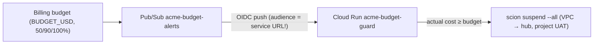

# 5. Cost and safety

## Cost levers (in order of impact)

1. **Model tiers.** Opus only for the lead, eng-managers and the architect.
   Sonnet for coding. Gemini Flash for review, audit, research, docs and
   exploratory QA.
2. **Wake-on-change watchdog + daily reincarnation.** `acme-factory-watchdog`
   (`infra/76-watchdog.sh`) polls GitHub and Hub state every 5 minutes and wakes
   `acme-lead` only when something changed (avoiding 48 daily blind Opus wakes
   after Anthropic's 5-minute prompt-cache TTL expires). At `04:00 UTC` daily,
   `acme-lead-reincarnate` reincarnates `acme-lead` with a handoff built from
   `"🏭 Factory status"` so context never grows unbounded across days. The
   6-hour `TICK` (`0 */6 * * *`) is the safety net.
3. **Idle mode.** With an empty backlog, everything is suspended and only
   approved work runs.
4. **Caps.** Per-role `max_duration`, `max_turns` and `max_model_calls`
   (3 × `max_turns`, which bounds runaway tool loops inside a turn), at most 4
   running agents besides the lead, and suspended agents are free. Caps apply
   when an agent starts or is reincarnated, so push templates with
   `infra/45-push-templates.sh` and let new agents pick them up.
5. **Fake LLM in CI.** `LLM_MODE=fake` for dev, tests and CI. Real model calls
   happen only in deployed demos.

## Switches

| Command | Effect | Keeps |
|---|---|---|
| `infra/60-factory.sh status` | VM state, tick schedule, agents by phase | — |
| `infra/60-factory.sh pause` | Pauses `TICK` and suspends every agent | Hub, UI, roster, graph, sessions |
| `infra/60-factory.sh resume` | Resumes `TICK` and wakes the lead | — |

**Product-owner rule: the VM is never stopped as a cost measure.** Token
consumption is the cost that matters.

## Budget guard



- **Acts on actual cost, never forecast.** Billing data lags by up to about a
  day, so plan for some overshoot.
- **Least privilege:** the guard SA has **no Compute roles**. A UAT with
  `agent:list,agent:lifecycle` for the project only is kept in Secret Manager.
- **Self-test:** a Cloud Run job with the guard's exact image, network, SA and
  token runs a read-only `scion list` against the hub. That proves the
  at-100% path without suspending anyone.
- **Wiring test** (no effect): publish
  `{"costAmount":1.23,"budgetAmount":1000}` to the topic, then expect `-> no
  action` with HTTP 204 in the guard logs.

## Credentials and access model

| Secret / credential | Where | Who can read | Rotation |
|---|---|---|---|
| `GITHUB_TOKEN` (fine-grained PAT) | hub project secret | agents in the project | product owner |
| Guard hub UAT | Secret Manager `acme-guard-hub-token` | guard SA | `ROTATE_TOKEN=1 infra/70-budget-guard.sh` (90d) |
| Watchdog hub UAT | Secret Manager `acme-watchdog-hub-token` | watchdog SA | `ROTATE_TOKEN=1 infra/76-watchdog.sh` (90d) |
| Collector hub UAT | Secret Manager `acme-observatory-hub-token` | collector SA | `ROTATE_TOKEN=1 infra/80-observatory-platform.sh` (90d) |
| Collector GitHub token | Secret Manager `acme-observatory-github-token` | collector + watchdog SAs | manual |
| IAP OAuth client ID/secret | Secret Manager `acme-iap-oauth-client-*` | operator | console + `55-iap-oauth-client.sh` |
| CD | GitHub Actions → WIF | `GITHUB_REPO@refs/heads/main` only | none needed (keyless) |

- **No service-account keys exist.** Agents run in `assign` mode as a dedicated
  low-privilege service account `acme-agent@<project>.iam.gserviceaccount.com`
  (`roles/aiplatform.user`, `logging.logWriter`, `monitoring.metricWriter`,
  `cloudtrace.agent`), minted on demand by the Hub metadata sidecar
  (`infra/25-agent-identity.sh`). The Hub default is `block` and the VM SA does
  not hold `roles/iam.serviceAccountAdmin` (`"hub_sa_minting": false`).
- **Deployer blast radius is resource-scoped.** `acme-observatory-deployer`
  holds `roles/run.viewer` at project level (for LRO polling) and
  `roles/run.developer` only on `acme-observatory`, `acme-irrops-demo`, and job
  `acme-observatory-collector`, so it cannot modify `scion-hub-acme-iap-proxy`,
  `acme-budget-guard`, or `acme-factory-watchdog`.
- **Secrets never pass through argv, files or logs.** Scripts read them from
  stdin and PUT them to APIs from memory. Values are never echoed. Validation
  prints status codes only.
- **Operator admin access is temporary.** Federation is enabled for the
  duration of an admin action. Every script that enables it disables it in a
  subshell `EXIT` trap and verifies `status` reads `disabled` afterwards.
- **Agents never change IAM or infra.** They file `needs operator` issues. The
  operator checks the diagnosis, grants the minimal role, codifies it in
  `infra/` plus a `verify.sh` assertion, and closes the issue with evidence.
- **New web users are viewers.** `DEFAULT_USER_ROLE=viewer` (`infra/50-web-access.sh`)
  lets anyone in `WEB_DOMAINS` watch the factory but not start agents billed to
  the project. Admins (`admin_emails`) are unaffected. The role applies only to
  users created after the change; promote someone in the hub UI if needed.
  Check: `verify.sh webaccess`.

## Backups

`infra/75-backups.sh` attaches the snapshot schedule `<VM_NAME>-daily-snapshots`
to the hub VM's boot disk: daily at 03:00 UTC, kept 7 days, stored in the
region. That disk holds `hub.db`, agent homes and workspaces. Snapshots are
crash-consistent, and SQLite recovers from them. Check: `verify.sh backups`.

**Restore** (the old VM stays untouched until you switch):
```bash
gcloud compute snapshots list --project=$PROJECT_ID --filter="sourceDisk~scion-hub"
gcloud compute disks create scion-hub-restore --project=$PROJECT_ID --zone=$ZONE \
  --source-snapshot=<snapshot> --type=pd-balanced
# Then stop the broken VM, swap its boot disk for the restored one (or create a VM
# from it with the same SA, network tags and metadata), start it, and run
# infra/verify.sh hub lead.
```

## Known residual risks (accepted for an experiment)

- **Shared GitHub identity.** All agents share one GitHub PAT (`GITHUB_TOKEN`),
  so GitHub's native "cannot approve your own PR" check cannot distinguish
  coder from reviewer. Mitigated by branch protection on `main`
  (`enforce_admins=true`, required status checks `backend`, `engine-smoke`,
  `frontend`, `pr-size`; `infra/35-github-repo.sh`), `collaborators_only`
  interaction limit, trusted-author rule #9, and `acme-reviewer`'s mandatory
  8-item verification checklist.
- **Broad web access** (resolved 2026-10-12): new users now default to `viewer`.
- **The PAT is broader than read-only** where it's reused for the Observatory.
