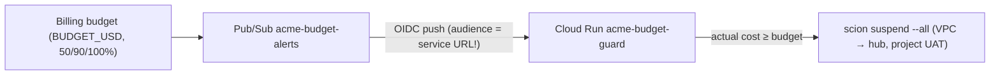

# 5. Cost and safety

## Cost levers (in order of impact)

1. **Model tiers.** Opus only for the lead, eng-managers and the architect.
   Sonnet for coding. Gemini Flash for review, audit, research, docs and
   exploratory QA.
2. **Event-driven loop.** Workers wake the lead. The 30-minute `TICK` is a
   safety net, and an unchanged-state tick is a one-line no-op.
3. **Idle mode.** With an empty backlog, everything is suspended and only
   approved work runs.
4. **Caps.** Per-role `max_duration` and `max_turns`, at most 4 running agents
   besides the lead, and suspended agents are free.
5. **Fake LLM in CI.** `LLM_MODE=fake` for dev, tests and CI. Real model calls
   happen only in deployed demos.

## Switches

| Command | Effect | Keeps |
|---|---|---|
| `infra/60-factory.sh status` | VM state, tick schedule, agents by phase | — |
| `infra/60-factory.sh pause` | Pauses `TICK` and suspends every agent | Hub, UI, roster, graph, sessions |
| `infra/60-factory.sh resume` | Resumes `TICK` and wakes the lead | — |

**Product-owner rule: the VM is never stopped as a cost measure.** Token
consumption is the cost that matters.

## Budget guard

- **Acts on actual cost, never forecast.** Billing data lags by up to about a
  day, so plan for some overshoot.
- **Least privilege:** the guard SA has **no Compute roles**. A UAT with
  `agent:list,agent:lifecycle` for the project only is kept in Secret Manager.
- **Self-test:** a Cloud Run job with the guard's exact image, network, SA and
  token runs a read-only `scion list` against the hub. That proves the
  at-100% path without suspending anyone.
- **Wiring test** (no effect): publish
  `{"costAmount":1.23,"budgetAmount":1000}` to the topic, then expect `-> no
  action` with HTTP 204 in the guard logs.

## Credentials and access model

| Secret / credential | Where | Who can read | Rotation |
|---|---|---|---|
| `GITHUB_TOKEN` (fine-grained PAT) | hub project secret | agents in the project | product owner |
| Guard hub UAT | Secret Manager `acme-guard-hub-token` | guard SA | `ROTATE_TOKEN=1 infra/70-budget-guard.sh` (90d) |
| Collector hub UAT | Secret Manager `acme-observatory-hub-token` | collector SA | `ROTATE_TOKEN=1 infra/80-observatory-platform.sh` (90d) |
| Collector GitHub token | Secret Manager `acme-observatory-github-token` | collector SA | manual |
| IAP OAuth client ID/secret | Secret Manager `acme-iap-oauth-client-*` | operator | console + `55-iap-oauth-client.sh` |
| CD | GitHub Actions → WIF | `GITHUB_REPO@refs/heads/main` only | none needed (keyless) |

- **No service-account keys exist.** Agents use the VM SA through the metadata
  server.
- **Secrets never pass through argv, files or logs.** Scripts read them from
  stdin and PUT them to APIs from memory. Values are never echoed. Validation
  prints status codes only.
- **Operator admin access is temporary.** Federation is enabled for the
  duration of an admin action. Every script that enables it disables it in a
  `trap` and verifies `status` reads `disabled` afterwards.
- **Agents never change IAM or infra.** They file `needs operator` issues. The
  operator checks the diagnosis, grants the minimal role, codifies it in
  `infra/` plus a `verify.sh` assertion, and closes the issue with evidence.

## Known residual risks (accepted for an experiment)

- **No GitHub-side protection.** All agents share one GitHub identity and
  there is no branch protection on a private repo without Pro. Merges to
  `main` are protected by team rules plus the reviewer verdict and CI only.
- **Broad web access.** `default_user_role: member` for `WEB_DOMAINS` lets
  anyone in those domains start agents billed to the project. Use `viewer` for
  anything beyond an experiment.
- **The PAT is broader than read-only** where it's reused for the Observatory.
