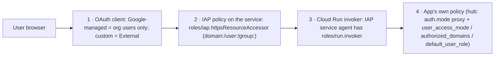

# 9. IAP: configuring user access to the factory's web UIs

Every human-facing surface of the factory runs on **Cloud Run with
Identity-Aware Proxy (IAP) enabled directly on the service**, with no load
balancer. This page has what we learned, what has to be configured, and how to
diagnose access problems.

## What sits behind IAP (current state)

| Service | IAP | Who reaches it | Notes |
|---|---|---|---|
| `scion-hub-acme-iap-proxy` | on | `domain:google.com`, `domain:duboc.altostrat.com` | Reverse proxy to the hub VM (`:8080`). The hub trusts IAP's signed header (`auth.mode: proxy`) |
| `acme-observatory` | on | same domains | Dashboard |
| `acme-irrops-demo` | on | same domains | Product demo |
| `acme-budget-guard` | **off** (by design) | only Pub/Sub, via OIDC push, as `roles/run.invoker` for the guard SA | Machine-to-machine; IAP would block Pub/Sub |

All three IAP services use the **same custom OAuth client**. On each one, the
only `roles/run.invoker` is the IAP service agent
`service-<PROJECT_NUMBER>@gcp-sa-iap.iam.gserviceaccount.com`.

Who bypasses IAP (by design): agents and the hub talk over `localhost:8080` on
the VM. The budget guard and the Observatory collector reach the hub over
**Direct VPC egress** (firewall allows `tcp:8080` from the subnet only). The
operator CLI runs on the VM through IAP **SSH tunnelling**, which is a
different IAP product (TCP forwarding, `roles/iap.tunnelResourceAccessor`).

## The access layers (all must allow a user)



| Layer | Fails as | Configure with |
|---|---|---|
| 1. OAuth client | IAP shows **"You don't have access"** to users outside the project's org, *even when layer 2 grants them* | Custom OAuth client: `infra/55-iap-oauth-client.sh` |
| 2. IAP policy | **"You don't have access"** | `gcloud iap web add-iam-policy-binding --resource-type=cloud-run --service=S --region=R --member=domain:D --role=roles/iap.httpsResourceAccessor` (`infra/50-web-access.sh`) |
| 3. Invoker | 403 from Cloud Run after login | `gcloud run services add-iam-policy-binding S --member=serviceAccount:service-<num>@gcp-sa-iap.iam.gserviceaccount.com --role=roles/run.invoker` |
| 4. App policy | The app's own "not authorized" or role limits | Hub: the marked block under `server.auth` in `settings.yaml` (`infra/50-web-access.sh`) |

## Learning 1: the Google-managed OAuth client admits only your organization

`gcloud beta run deploy … --iap` enables IAP with a **Google-managed OAuth
client**. Per the Cloud IAP docs, *"Google-managed OAuth clients can only be
used to manage access for internal users that are within an organization. You
must use a custom OAuth configuration to manage access for external users."*

Our project lives in the `duboc.altostrat.com` organization. `domain:google.com`
was correctly bound in layer 2, yet `duboc@google.com` got "You don't have
access" until we applied a custom client. IAM looked right while the OAuth
client was the blocker.

**Rule:** if any user is outside the project's org, configure a custom OAuth
client on every IAP service **before** sharing URLs.

### Configuring the custom OAuth client (one time per project)

These console steps can't be scripted; the brand/client APIs are deprecated.
In project `<PROJECT_ID>`:

1. **Google Auth Platform → Branding:** app name (e.g. "ACME Factory"), plus a
   support email and developer contact.
2. **Audience:** user type **External**, then **Publish app**, so the status
   reads **In production**. In *Testing*, only listed test users can sign in.
   IAP needs only basic scopes (`openid`, `email`, `profile`), so no
   verification review is required.
3. **Clients → Create client:** type **Web application**. After creating it,
   add the authorized redirect URI
   `https://iap.googleapis.com/v1/oauth/clientIds/<CLIENT_ID>:handleRedirect`
   (with the literal client ID substituted).
4. Run `infra/55-iap-oauth-client.sh`. It prompts for the client ID (shown)
   and secret (hidden), stores both in Secret Manager
   (`acme-iap-oauth-client-id`, `acme-iap-oauth-client-secret`), and applies
   them to every IAP service with:
   ```yaml
   # gcloud iap settings set <file> --resource-type=cloud-run --service=<S> --region=<R>
   access_settings:
     oauth_settings:
       client_id: "<CLIENT_ID>"
       client_secret: "<SECRET>"     # written to a 0600 temp file, removed on exit
   ```
5. Check: `infra/verify.sh iap-oauth`, which asserts each service has a custom
   `clientId`.

Lessons from doing it: don't put `<CLIENT_ID>` placeholders in shell
one-liners. In zsh, `<…>` is an input redirect, and long pasted lines wrap
mid-word. That's why the script prompts instead.

## Learning 2: the binding must be on the *service*, at the right level

- `gcloud iap web add-iam-policy-binding --resource-type=cloud-run
  --service=<S> --region=<R>` binds **one service**. Use this.
- **The failed-grant fallback:** `deploy.sh` tried that grant for the deployer.
  Because `cloudresourcemanager.googleapis.com` wasn't enabled yet, it failed
  and **fell back to a project-level** `roles/iap.httpsResourceAccessor` for
  the admin. That still works, but it covers every IAP resource in the
  project. Enable CRM in bootstrap (we do now). You may remove the leftover
  project-level grant once service-level bindings exist:
  `gcloud projects remove-iam-policy-binding <P> --member=user:<admin> --role=roles/iap.httpsResourceAccessor`.
- **Prefer domains or groups:** grant `domain:` or `group:` rather than
  individual `user:` bindings where you can.

## Learning 3: IAP is necessary but not sufficient for the hub

The hub runs `auth.mode: proxy` with `proxy.provider: iap` and an
**audience** of
`/projects/<PROJECT_NUMBER>/locations/<REGION>/services/scion-hub-<hub>-iap-proxy`.
It verifies IAP's signed JWT (`x-goog-iap-jwt-assertion`: signature, issuer,
audience, expiry). After IAP lets a user through, the hub applies its own
sign-in policy:

```yaml
server:
  auth:
    user_access_mode: domain_restricted        # defence in depth if IAP grants widen
    authorized_domains: ["google.com", "duboc.altostrat.com"]
    default_user_role: viewer                  # DEFAULT_USER_ROLE; viewers can't start agents
```

`admin_emails` users are always admins. Changing `default_user_role` affects
new users only.

## Learning 4: re-deploys reset hub settings

`deploy.sh` rewrites `settings.yaml` on every run. **After any hub
re-deploy:**

```bash
infra/50-web-access.sh                 # IAP bindings + hub sign-in policy block
infra/55-iap-oauth-client.sh --reapply # custom OAuth client on all IAP services (from Secret Manager)
```

New IAP services (for example a new demo) must be added to the `SERVICES` list
in `55-iap-oauth-client.sh`. Missing services are skipped, so it's safe to list
services you'll deploy later.

## Learning 5: programmatic access through IAP is a different problem

Browser access works with the setup above. **Scripts and CLIs** calling an
IAP-protected Cloud Run URL need an OIDC token IAP accepts. A gcloud user ID
token (`aud` = the gcloud client) isn't accepted by default. We avoided the
problem instead of solving it:
- **Operator admin:** IAP SSH to the VM, then the `scion` CLI against
  `localhost:8080` with temporary federation (`infra/30-hub-admin-access.sh`).
- **Machine paths** (guard, collector): Direct VPC egress plus a hub user
  access token. Neither touches IAP.
- **E2E proof for the demo:** server-side signals (Cloud Run revision status,
  engine traces) rather than HTTP calls through IAP.

If you need scripted access through IAP, use a service account ID token with
the audience IAP expects for Cloud Run, or a programmatic-access allowlist on
the custom OAuth client. Test it explicitly; we didn't need it.

## Checklist: adding a new IAP-protected service

1. Deploy with `gcloud beta run deploy <S> … --no-allow-unauthenticated --iap`,
   with a dedicated runtime SA holding minimal roles.
2. Grant the IAP service agent `roles/run.invoker` on the service. `--iap`
   does this, but only warns on failure, so do it explicitly.
3. Grant `roles/iap.httpsResourceAccessor` on the service for each
   `WEB_DOMAINS` domain or group.
4. Add the service to `SERVICES` in `infra/55-iap-oauth-client.sh` and run
   `--reapply`.
5. Make sure CI/CD deploys **only swap `--image`**. Never re-specify
   `--iap`/`--no-allow-unauthenticated` differently, never
   `--allow-unauthenticated`, and never add `allUsers`.
6. Verify: log in as one user from each domain, and add a `verify.sh` check
   (IAP enabled + accessors + custom client).

## Troubleshooting

| Symptom | Likely cause | Check / fix |
|---|---|---|
| "You don't have access", user outside the org | Google-managed OAuth client | `gcloud iap settings get --resource-type=cloud-run --service=S --region=R` shows no `oauthSettings.clientId`. Fix: custom client (Learning 1) |
| "You don't have access", user in an allowed domain and the client is custom | Missing service-level accessor binding, or the wrong account is signed in | `gcloud iap web get-iam-policy --resource-type=cloud-run --service=S --region=R`. The error page shows the user it evaluated (multi-account browsers!) |
| Consent screen error, or only some users get in | OAuth app in **Testing**, or audience **Internal** | Audience → External + In production |
| `redirect_uri_mismatch` after login | Redirect URI missing, or has a placeholder | Add `https://iap.googleapis.com/v1/oauth/clientIds/<CLIENT_ID>:handleRedirect` |
| 403 from Cloud Run after successful login | IAP service agent lacks `run.invoker` | `gcloud run services get-iam-policy S` |
| Logged in, but the hub rejects the user | Hub sign-in policy, or an audience mismatch | `settings.yaml` `server.auth` block; `sudo journalctl -u scion-hub` (audience errors appear there) |
| Worked before, broke after a hub redeploy | `settings.yaml` was rewritten | Re-run `50-web-access.sh` and `55-iap-oauth-client.sh --reapply` |
| Requests rejected by IAP leave no trace | IAP-rejected requests never reach Cloud Run or the hub | Enable **Data Access audit logs** (DATA_READ) for `iap.googleapis.com`, then filter `protoPayload.serviceName="iap.googleapis.com" protoPayload.authorizationInfo.granted=false`. It's billed, so turn it off after diagnosing |

## Quick inspection commands

```bash
P=<project>; R=<region>
for s in $(gcloud run services list --region=$R --project=$P --format='value(metadata.name)'); do
  echo "== $s"
  gcloud run services describe $s --region=$R --project=$P --format='value(metadata.annotations."run.googleapis.com/iap-enabled")'
  gcloud iap web get-iam-policy --resource-type=cloud-run --service=$s --region=$R --project=$P --format='value(bindings)'
  gcloud iap settings get --resource-type=cloud-run --service=$s --region=$R --project=$P --format='value(accessSettings.oauthSettings.clientId)'
done
gcloud projects get-iam-policy $P --flatten=bindings --filter='bindings.role:roles/iap.httpsResourceAccessor' --format='value(bindings.members)'
```
