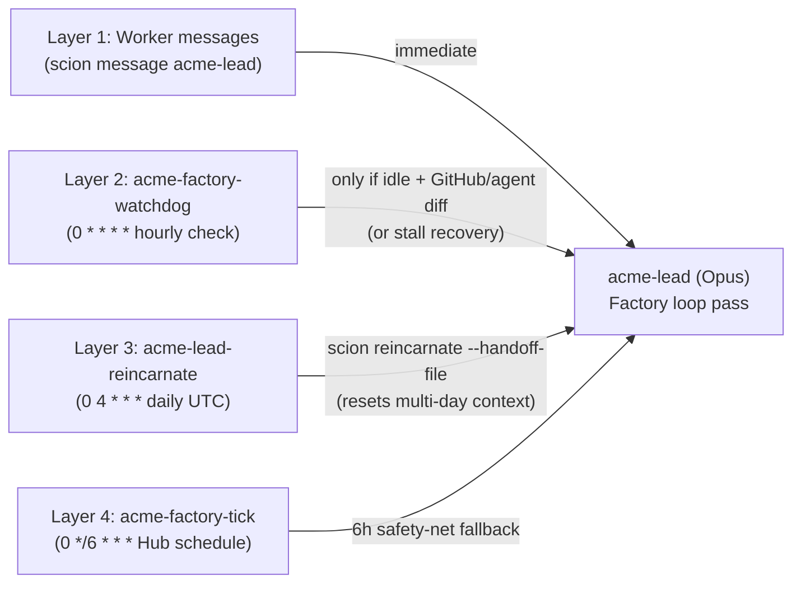
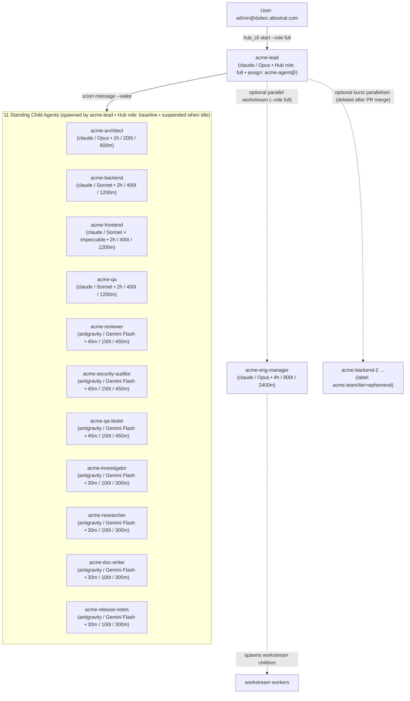

# 11. Scion configuration reference: planes, heartbeat, and agent hierarchy

Running an autonomous [Scion](https://github.com/GoogleCloudPlatform/scion) software factory on a single GCE VM behind Cloud Run IAP requires configuring **six distinct surfaces** (deployer JSON, YAML config, SQLite `hub.db` state, temporary OAuth federation, Hub REST API, and project-scoped User Access Tokens). This guide documents every mechanism we used, how the 4-layer heartbeat keeps the factory running without burning prompt cache, and how the 13-role agent hierarchy is structured.

---

## 1. The six Scion configuration planes

| # | Plane | Where it lives | What it controls | Scripts that use it |
|---|---|---|---|---|
| **1** | **Single-node VM deployer** | `infra/deploy-config.json` → `scripts/single-node-vm/deploy.sh` | GCE VM (`scion-hub-acme`), systemd `scion-hub.service`, Docker runtime, `scion-antigravity` image, Cloud Run IAP proxy (`scion-hub-acme-iap-proxy`) | [`infra/10-deploy-hub.sh`](../../infra/10-deploy-hub.sh), [`infra/20-model-access.sh`](../../infra/20-model-access.sh) |
| **2** | **Hub `settings.yaml` + `hub_settings` SQLite sync** | `/home/scion/.scion/settings.yaml` & `/home/scion/.scion/hub.db` (`hub_settings`) | `server.auth` (`user_access_mode`, `authorized_domains`, `default_user_role`), `default_gcp_identity_mode`, `telemetry.cloud` | [`infra/25-agent-identity.sh`](../../infra/25-agent-identity.sh), [`infra/50-web-access.sh`](../../infra/50-web-access.sh) |
| **3** | **Temporary operator federation (`hub_cli`)** | `server.auth.trusted_proxies.federation` in `settings.yaml` | Short-lived admin CLI access on `http://localhost:8080` using `gcloud auth print-identity-token` over SSH stdin | [`infra/30-hub-admin-access.sh`](../../infra/30-hub-admin-access.sh), [`infra/lib.sh`](../../infra/lib.sh) |
| **4** | **Direct Hub REST API (`/api/v1/…`)** | `http://localhost:8080/api/v1/` on the VM | Project secrets from stdin (`PUT /api/v1/secrets/…`), registering/verifying `acme-agent@` GCP SA, setting project-default `assign` identity | [`infra/31-set-project-secret.sh`](../../infra/31-set-project-secret.sh), [`infra/25-agent-identity.sh`](../../infra/25-agent-identity.sh) |
| **5** | **Project-scoped UATs (`scion_pat_*`)** | Secret Manager → Cloud Run services over Direct VPC egress (`tcp:8080`) | Unattended automation (`acme-factory-watchdog`, `acme-budget-guard`, `acme-observatory-collector`) without opening admin federation | [`infra/70-budget-guard.sh`](../../infra/70-budget-guard.sh), [`infra/76-watchdog.sh`](../../infra/76-watchdog.sh), [`infra/80-observatory-platform.sh`](../../infra/80-observatory-platform.sh) |
| **6** | **Global templates & `hub.db` tables** | `factory/templates/acme-*` → Hub storage + `hub.db` (`agents`, `projects`, `schedules`) | 13 role templates, vendored skills, agent `applied_config` (`gcpIdentity`), lineage (`ancestry`/`created_by`), and recurring schedules | [`infra/40-build-team-templates.sh`](../../infra/40-build-team-templates.sh), [`infra/45-push-templates.sh`](../../infra/45-push-templates.sh), [`infra/60-factory.sh`](../../infra/60-factory.sh) |

---

### Plane 1: Single-node VM deployer (`deploy.sh` + `infra/deploy-config.json`)

[`infra/10-deploy-hub.sh`](../../infra/10-deploy-hub.sh) shallow-clones `GoogleCloudPlatform/scion` at `SCION_VERSION` (`nightly-20261009`) into `.cache/`, applies an idempotent 2-line patch so `deploy.sh` honours `DEPLOY_ZONE` (`us-central1-a`), and runs `./scripts/single-node-vm/deploy.sh --config infra/deploy-config.json </dev/null`.

Key fields in [`infra/deploy-config.json`](../../infra/deploy-config.json):
- `"hub_sa_minting": false` — prevents `deploy.sh` from re-granting `roles/iam.serviceAccountAdmin` to the Hub VM service account on redeploys.
- `"harnesses": ["gemini", "claude"]` — seeds Hub config for both harnesses; [`infra/20-model-access.sh`](../../infra/20-model-access.sh) then builds `localhost/scion/scion-claude:latest` on the VM from `/opt/scion-source/harnesses/claude`.

### Plane 2: `/home/scion/.scion/settings.yaml` vs. SQLite `hub_settings` (`origin='seeded'` vs `'api'`)

On startup (`systemctl restart scion-hub`), Scion's `SeedSettingsFromConfig` reads `/home/scion/.scion/settings.yaml` and seeds the `hub_settings` table in `/home/scion/.scion/hub.db` **only for rows whose `origin` is `'seeded'`**.
- **Critical gotcha:** If a section (`access` or `telemetry`) was ever modified via the web UI or REST API, its row in `hub_settings` has `origin = 'api'`, and edits to `settings.yaml` are silently ignored on restart.
- **How our scripts apply settings deterministically:**
  - **Domain access (`infra/50-web-access.sh`):** Writes `user_access_mode: domain_restricted`, `authorized_domains: [...]`, and `default_user_role: viewer` under `server.auth` in `settings.yaml`, then updates `hub_settings` where `section='access'` with `origin='seeded'` before restarting `scion-hub`.
  - **Telemetry (`infra/25-agent-identity.sh`):** Writes the `telemetry.cloud` block to `settings.yaml` and upserts `section='telemetry'` in `hub_settings` (`enabled=true`, `cloud.enabled=true`).
  - **Default GCP identity mode (`infra/25-agent-identity.sh`):** Sets top-level `default_gcp_identity_mode: block` in `settings.yaml` so no container outside configured projects can read the VM metadata server.

### Plane 3: Temporary operator federation (`infra/30-hub-admin-access.sh` + `hub_cli`)

Because the Hub runs in `auth.mode: proxy` behind Cloud Run IAP, `scion` CLI has no non-interactive login flow, and User Access Tokens (`scion_pat_*`) are forbidden from creating projects or setting secrets.
1. `infra/30-hub-admin-access.sh enable` inserts a marked `server.auth.trusted_proxies.federation` block into `/home/scion/.scion/settings.yaml` trusting Google ID tokens minted by the `gcloud` CLI (`oauthClient: 32555940559.apps.googleusercontent.com`) for `ORG_DOMAIN` (`duboc.altostrat.com`), and restarts `scion-hub`.
2. `hub_cli` (in [`infra/lib.sh`](../../infra/lib.sh)) pipes `gcloud auth print-identity-token` over SSH stdin to the VM and runs `scion --hub http://localhost:8080 --token "$tok" …` as `admin@duboc.altostrat.com`.
3. `infra/30-hub-admin-access.sh disable` removes the block and restarts `scion-hub`. All caller scripts wrap `enable` in an `EXIT` trap and assert `status == disabled`.

### Plane 4: Direct Hub REST API calls (`/api/v1/…`)

Three operations use `curl` against `http://localhost:8080/api/v1/…` on the VM (authenticated with the operator token on stdin) because the `scion` CLI either lacks the subcommand in unlinked directories or would expose secrets in `argv`:

1. **Project secrets (`infra/31-set-project-secret.sh`):**
   - `scion hub secret set` either takes the secret on `argv` (leaking in `/proc`) or via `@file` (which base64-encodes it as `type=file`).
   - Instead, `31-set-project-secret.sh` sends `PUT /api/v1/secrets/GITHUB_TOKEN` with `{"value": "<stdin>", "scope": "project", "scopeId": "<project-uuid>", "type": "environment", "injectionMode": "always"}`.
2. **Registering & verifying the dedicated agent service account (`infra/25-agent-identity.sh`):**
   - `scion service-accounts` requires a local `.scion` workspace link when `--project` is passed.
   - Instead, `25-agent-identity.sh` calls:
     - `POST /api/v1/projects/<uuid>/gcp-service-accounts` (`{"email": "acme-agent@acme-airlines-factory.iam.gserviceaccount.com", "display_name": "ACME factory agent runtime"}`)
     - `POST /api/v1/projects/<uuid>/gcp-service-accounts/<sa-id>/verify` (verifies `iam.serviceAccountTokenCreator` impersonation)
     - `PATCH /api/v1/projects/<uuid>/settings` (`{"default_gcp_identity_mode": "assign", "default_gcp_identity_service_account_id": "<sa-id>"}`)

### Plane 5: Project-scoped User Access Tokens (`scion_pat_*`) over Direct VPC Egress

Unattended Cloud Run services talk directly to `http://<vm-internal-ip>:8080` over the `default` VPC (`--vpc-egress=private-ranges-only`) using 90-day project-scoped UATs stored in Secret Manager (minted via `hub_cli hub token create --project duboc-acme-airlines`):

| Service | Secret | UAT Scopes | Purpose |
|---|---|---|---|
| `acme-factory-watchdog` | `acme-watchdog-hub-token` | `agent:list,agent:read,agent:message,agent:lifecycle` | Hourly wake-on-change, stall recovery (`scion resume`/`reincarnate`), daily `04:00 UTC` lead reincarnation |
| `acme-budget-guard` | `acme-guard-hub-token` | `agent:list,agent:lifecycle` | Runs `scion suspend --all` when monthly billing reaches 100% of `$2,000` |
| `acme-observatory-collector` | `acme-observatory-hub-token` | `agent:list,agent:read` | Reads agent state and activity into BigQuery `factory_ops` |

---

## 2. The heartbeat architecture (how the factory stays alive)

To keep the backlog moving 24/7 without waking `acme-lead` (Claude Opus) unnecessarily after Anthropic's 5-minute prompt-cache TTL expires, the factory uses a **4-layer heartbeat**:

| Layer | Trigger & schedule | Mechanism | Why it exists |
|---|---|---|---|
| **1. Event-driven worker messages** | Immediate on worker milestone | Workers run `scion message acme-lead "PR #N ready"` or `"review verdict posted"` before suspending | Drives fast multi-step progress during active work, often landing inside the 5-minute Opus prompt-cache window |
| **2. Hourly wake-on-change watchdog** | Cloud Scheduler `acme-factory-watchdog` (`0 * * * *` UTC) → Cloud Run `POST /check` | Computes SHA-256 fingerprint over open GitHub issues (excluding `"🏭 Factory status"`), open PRs, recent `main` workflow runs, and child agent `(slug, phase, activity)` states. Wakes `acme-lead` only if idle (`blocked`/`waiting_for_input`/`completed`) AND the fingerprint changed (rate-limited to 1 wake / 55 min). Never wakes a `suspended` lead | Catches external GitHub changes (new PO issues, completed CI runs) and self-heals `stopped`/`error` (`scion resume`) or `stalled` (`scion message`, then `scion reincarnate` + PO alert on next hourly check) without polling every 5 minutes |
| **3. Daily lead reincarnation** | Cloud Scheduler `acme-lead-reincarnate` (`0 4 * * *` UTC) → Cloud Run `POST /reincarnate` | Builds a structured markdown handoff from the pinned `"🏭 Factory status"` issue + live child roster and runs `scion reincarnate acme-lead --handoff-file …` | Prevents multi-day Opus context accumulation (`cache_write_input` bloat) while preserving `acme-lead`'s UUID, slug, and parent-child lineage |
| **4. Hub safety-net tick** | Hub recurring schedule `acme-factory-tick` (`0 */6 * * *` UTC) | Internal SQLite schedule inside `scion-hub` sending `TICK:` to `acme-lead` | Pure Hub-internal fallback if Cloud Run or GitHub API is temporarily unreachable |

---

## 3. The 13-agent roster & hierarchy of agents

### 3.1 Lineage tree (`created_by` / `ancestry` in `hub.db`)

Scion's **Agent Lineage Graph** (Hub UI → Project → Agents → **graph** view) constructs parent→child edges from the `created_by` / `ancestry` columns recorded when an agent is created (`scion start`).

### 3.2 Rules that preserve the hierarchy

1. **Operator starts only `acme-lead`:** The operator never runs `scion start acme-backend` directly (which would make `admin@duboc.altostrat.com` the parent and orphan the worker outside `acme-lead`'s subtree). Instead, `acme-lead` runs with Hub role `full` (`agent:create`, `agent:lifecycle`, `agent:message`, `agent:list`) and spawns the 11 standing agents itself.
2. **Workers run with Hub role `baseline`:** Standing workers omit `--role` (receiving `baseline`), so they can message `acme-lead` and update their own status (`sciontool status`), but cannot spawn or delete other agents.
3. **Suspend (`scion suspend`), never delete standing agents:** In Scion, `scion delete` hard-deletes the row in `agents`, removing the node from the lineage graph. Standing agents (`acme.team/tier=standing`) are **suspended** when idle (0 CPU/token cost) and woken with `scion message --wake <agent> "<task>"`.
4. **Reincarnation preserves lineage:** When `acme-lead` is reincarnated daily (`scion reincarnate acme-lead --handoff-file …`), Scion replaces the container and resets the conversation while keeping the same `agents.id` UUID, so all 11 standing agents remain attached to `acme-lead`.
5. **Automated verification (`infra/verify.sh topology`):** Queries `scion list --format json` and asserts that `acme-lead` exists, at least 11 standing `acme-*` children exist, and every live `acme-*` agent has `acme-lead`'s UUID in its `ancestry`.
