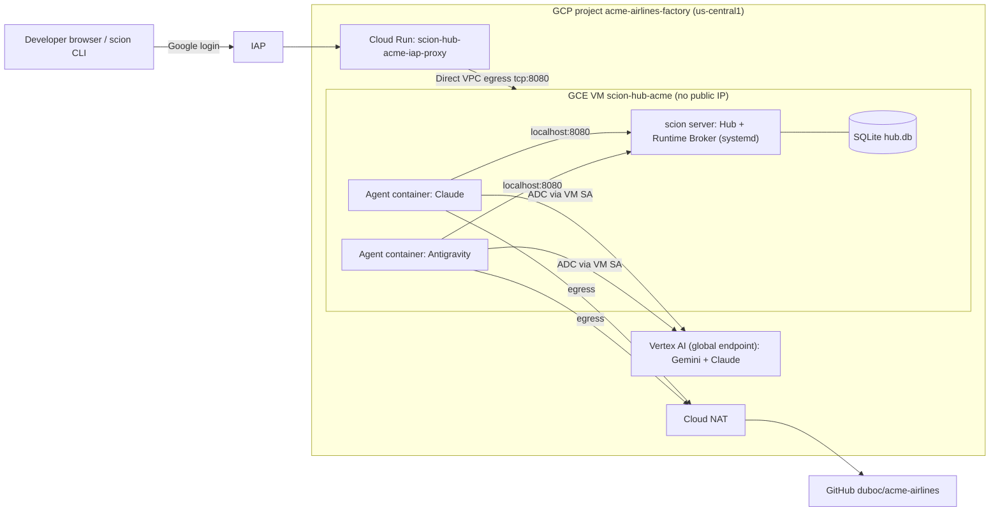

# Factory Overview

The acme-airlines software factory is a single-node
[Scion](https://github.com/GoogleCloudPlatform/scion) deployment on Google Cloud.
Design: [spec](../superpowers/specs/2026-10-09-scion-factory-design.md).

## Architecture

## Project

| Field | Value |
|-------|-------|
| Project ID | `acme-airlines-factory` |
| Project number | `493084803309` |
| Parent | folder `dubofolder` (`543080121395`) in org `duboc.altostrat.com` |
| Billing | `01820C-6329B4-8A7409` (Argolis Billing) |
| Region | `us-central1` |
| gcloud config | `acme-factory` (`CLOUDSDK_ACTIVE_CONFIG_NAME=acme-factory`) |

### Effective org policies (checked 2026-10-09)

| Constraint | Effective | Impact |
|------------|-----------|--------|
| `compute.skipDefaultNetworkCreation` | enforced | No `default` VPC; bootstrap creates an auto-mode one. |
| `compute.requireShieldedVm` | not enforced | deploy.sh uses Shielded VM anyway. |
| `compute.vmExternalIpAccess` | allow all | VM still has no public IP by design. |
| `iam.allowedPolicyMemberDomains` | allow all | — |
| `iam.disableServiceAccountKeyCreation` | not enforced | We don't create SA keys regardless. |
| `compute.requireOsLogin` | not enforced | — |
| `run.allowedIngress` | allow all | — |
| `gcp.resourceLocations` | allow all | — |

## Resource inventory

_Filled in after hub deployment (Task 3)._

## Cost

_Filled in in Task 7._
