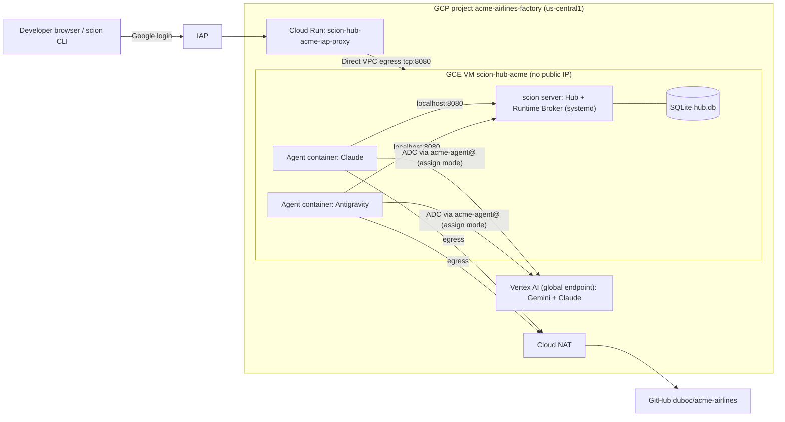

# Factory Overview

The acme-airlines software factory is a single-node
[Scion](https://github.com/GoogleCloudPlatform/scion) deployment on Google Cloud.
Design: [spec](../superpowers/specs/2026-10-09-scion-factory-design.md).

## Architecture

## Project

| Field | Value |
|-------|-------|
| Project ID | `acme-airlines-factory` |
| Project number | `493084803309` |
| Parent | folder `dubofolder` (`543080121395`) in org `duboc.altostrat.com` |
| Billing | `01820C-6329B4-8A7409` (Argolis Billing) |
| Region | `us-central1` |
| gcloud config | `acme-factory` (`CLOUDSDK_ACTIVE_CONFIG_NAME=acme-factory`) |

### Effective org policies (checked 2026-10-09)

| Constraint | Effective | Impact |
|------------|-----------|--------|
| `compute.skipDefaultNetworkCreation` | enforced | No `default` VPC; bootstrap creates an auto-mode one. |
| `compute.requireShieldedVm` | not enforced | deploy.sh uses Shielded VM anyway. |
| `compute.vmExternalIpAccess` | allow all | VM still has no public IP by design. |
| `iam.allowedPolicyMemberDomains` | allow all | — |
| `iam.disableServiceAccountKeyCreation` | not enforced | We don't create SA keys regardless. |
| `compute.requireOsLogin` | not enforced | — |
| `run.allowedIngress` | allow all | — |
| `gcp.resourceLocations` | allow all | — |

## Resource inventory

| Resource | Name | Notes |
|----------|------|-------|
| Hub URL | <https://scion-hub-acme-iap-proxy-vdhcml5ceq-uc.a.run.app> | Google login via IAP |
| GCE VM | `scion-hub-acme` (`us-central1-a`) | n2-standard-16, 500 GB, Ubuntu 22.04, Shielded VM, no public IP |
| Scion | `nightly-20261009` | Hub + runtime broker in one systemd unit `scion-hub.service` |
| VM service account | `scion-hub-acme@acme-airlines-factory.iam.gserviceaccount.com` | Hub/Broker host SA (`iam.serviceAccountTokenCreator` on `acme-agent@`; no `serviceAccountAdmin`) |
| Agent service account | `acme-agent@acme-airlines-factory.iam.gserviceaccount.com` | Dedicated agent identity (`assign` mode; `aiplatform.user`, `logging.logWriter`, `monitoring.metricWriter`, `cloudtrace.agent`) |
| Watchdog | Cloud Run `acme-factory-watchdog` + Scheduler (`0 * * * *`, `0 4 * * *`) | Hourly wake-on-change, stall recovery, daily `04:00 UTC` lead reincarnation, PO alert policy |
| Proxy service account | `scion-hub-acme-proxy@…` | No project roles |
| Cloud Run | `scion-hub-acme-iap-proxy` | IAP-enforced reverse proxy → VM:8080 |
| Artifact Registry | `cloud-run-source-deploy` (`us-central1`) | Holds the proxy image |
| Cloud Router / NAT | created by deploy.sh | Egress for the private VM |
| Firewall | `scion-hub-acme-allow-iap-ssh`, `scion-hub-acme-allow-proxy` | Scoped to tag `scion-hub-acme` |
| Container images (on VM) | `localhost/scion/{core-base,scion-base,scion-antigravity,scion-claude}:latest` | Built from `/opt/scion-source` |

## Cost

About **$650/month** if left running 24/7, plus Vertex AI usage. See the breakdown in [operations](02-operations.md#cost-us-central1-list-prices-approximate).

## Agent team

Thirteen role templates (`acme-lead`, `acme-eng-manager`, `acme-architect`, `acme-backend`, `acme-frontend`, `acme-qa`, `acme-qa-tester`, `acme-reviewer`, `acme-security-auditor`, `acme-investigator`, `acme-researcher`, `acme-doc-writer`, `acme-release-notes`): see [docs/factory/team.md](../factory/team.md) and [docs/scion/11-scion-configuration-reference.md](../scion/11-scion-configuration-reference.md).
