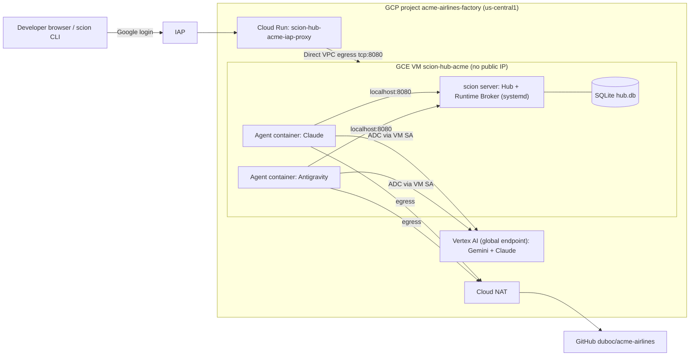

# Factory Overview

The acme-airlines software factory is a single-node
[Scion](https://github.com/GoogleCloudPlatform/scion) deployment on Google Cloud.
Design: [spec](../superpowers/specs/2026-10-09-scion-factory-design.md).

## Architecture

## Project

_Filled in during bootstrap (Task 2)._

## Resource inventory

_Filled in after hub deployment (Task 3)._

## Cost

_Filled in in Task 7._
