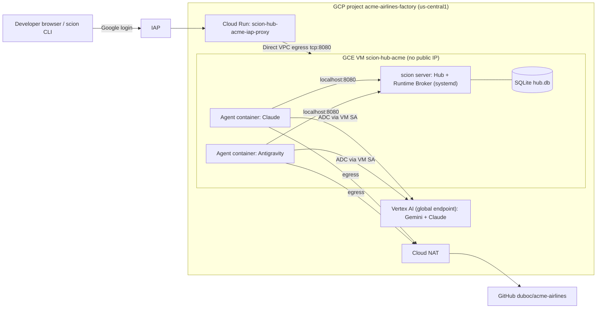

# Scion Software Factory on a Single GCP VM — Design

- **Date:** 2026-10-09
- **Status:** Draft (awaiting review)
- **Owner:** admin@duboc.altostrat.com

## 1. Intent

Stand up [Scion](https://github.com/GoogleCloudPlatform/scion) on a single GCE VM in a
dedicated, new GCP project so it can act as a "software factory": a Hub where
LLM coding agents (Gemini/Antigravity and Claude) are dispatched to work on the
`acme-airlines` repository and deliver changes as GitHub pull requests.

Everything done to build the factory is documented in this repository
(`duboc/acme-airlines`), which will also hold the application source.

### Success criteria (v1)

1. New GCP project `acme-airlines-factory` exists under folder `dubofolder`
   with billing linked.
2. Scion Hub + co-located runtime broker run on one VM (`scion-hub-acme`),
   reachable in a browser only through the IAP-protected Cloud Run proxy.
3. `acme-airlines` is registered as a Hub project with a `GITHUB_TOKEN`
   project secret.
4. One Antigravity (Gemini) agent **and** one Claude agent each, using Vertex AI
   via the VM service account, clone the repo and open a PR.
5. A reader can reproduce the whole setup from `docs/setup/` and tear it down.

### Out of scope (v1)

- Defining the acme-airlines application (stack, features) — `app/` stays empty.
- Role templates / multi-agent team workflows (PM, architect, reviewer…).
- HA, Cloud SQL, GCS storage, Secret Manager, GKE hybrid tier, chat plugins.

## 2. Decisions

| # | Decision | Rationale |
|---|----------|-----------|
| D1 | Use Scion's supported `scripts/single-node-vm/deploy.sh --config` (headless) | Idempotent, supported, already handles IAP proxy, NAT, firewall, shielded VM, hardened-org quirks. Avoids a bespoke Terraform fork. |
| D2 | New project `acme-airlines-factory` in `dubofolder`, billing `01820C-6329B4-8A7409`, region `us-central1` | Isolation of cost/IAM; region with broad service availability. |
| D3 | Machine size *medium* (n2-standard-16), 500 GB disk | Room for several concurrent agents plus on-VM image builds. |
| D4 | Container images built locally on the VM (`source: build`) + extra `scion-claude` build | Simplest; no registry to manage. deploy.sh only builds Antigravity, so Claude is built as a post-step. |
| D5 | LLM auth = Vertex AI via the VM service account (metadata-server ADC) for both harnesses | No API keys to manage or leak. Hub seeds `GOOGLE_CLOUD_PROJECT` and `GOOGLE_CLOUD_LOCATION=global`. |
| D6 | GitHub auth = fine-grained PAT scoped to `duboc/acme-airlines` (Contents RW, Pull requests RW, Metadata R), stored as a project-scoped `GITHUB_TOKEN` hub secret, set by the human | Least setup; the token never passes through agent chat or git history. GitHub App can replace it later. |
| D7 | Update policy `notify` | Avoid surprise binary swaps mid-session; admin upgrades deliberately. |
| D8 | Hub name `acme` | Resource names derive from it (`scion-hub-acme`, `scion-hub-acme-iap-proxy`). |

## 3. Architecture



## 4. Components and steps

### 4.1 Project bootstrap (scripted: `infra/00-bootstrap-project.sh`)
1. `gcloud projects create acme-airlines-factory --folder=543080121395`
   (append a short suffix if the ID is taken; record the final ID).
2. Link billing account `01820C-6329B4-8A7409`.
3. Enable APIs: `compute run iap cloudbuild artifactregistry aiplatform
   iamcredentials logging monitoring`.
4. Inspect effective org policies (`gcloud org-policies list --project`) and
   record any relevant constraints in the runbook.
5. Ensure a `default` VPC with a `default` subnet in `us-central1` exists
   (create auto-mode network if `skipDefaultNetworkCreation` applied).

### 4.2 Hub deployment (scripted: `infra/10-deploy-hub.sh` → `deploy.sh`)
- Config committed at `infra/deploy-config.json`:
  `hub_name=acme`, `project_id=<final id>`, `region=us-central1`,
  `machine_size=medium`, `disk_size_gb=500`, `chat_plugins=[]`,
  `container_images.source=build`, `admin_email=admin@duboc.altostrat.com`,
  `update_policy=notify`.
- Run from a checkout of the Scion repo; record the Scion release version used.
- Output: VM, two service accounts, Cloud Run IAP proxy, firewall rules,
  Cloud NAT, IAP binding for the deployer. Record the proxy URL.

### 4.3 Model access (scripted: `infra/20-model-access.sh`)
1. Grant `roles/aiplatform.user` to the hub VM SA
   (`scion-hub-acme@<project>.iam.gserviceaccount.com`).
2. Build `scion-claude` on the VM from the same Scion source checkout used by
   the image build, tagged `localhost/scion/scion-claude:latest`.
3. **Manual (human):** enable Claude models in Vertex AI Model Garden for the
   project (terms acceptance in console). Document the exact models enabled.
4. Verify: from the VM, a Vertex `generateContent` call for Gemini and a
   `rawPredict` call for Claude succeed with metadata-server credentials.

### 4.4 Repository + Hub project
1. Initial commit to `acme-airlines` `main`: `README.md`, `AGENTS.md`,
   `docs/`, `infra/`, `app/.gitkeep`, `.gitignore`.
2. `scion hub project create https://github.com/duboc/acme-airlines.git`
   (CLI pointed at the Hub through IAP, or run on the VM against localhost).
3. **Manual (human):** create the fine-grained PAT and set it with
   `scion hub secret set --project acme-airlines GITHUB_TOKEN` (stdin) or via
   the Hub web UI. The runbook gives the exact command; the value is never
   pasted into chat or committed.

### 4.5 Smoke test
- Start `smoke-gemini` (harness `antigravity`) and `smoke-claude`
  (harness `claude`), each with a task: "add your harness name and today's
  date to `docs/factory/smoke-tests.md` on a new branch and open a PR".
- Pass = two PRs opened on GitHub, agents reach COMPLETED.
- Stop/delete the smoke agents afterwards.

### 4.6 Documentation layout (this repo)

```
README.md                         # what this repo is, links
AGENTS.md                         # rules for agents working in this repo
app/                              # application (future, built by agents)
infra/
  deploy-config.json              # headless deploy.sh answers (no secrets)
  00-bootstrap-project.sh
  10-deploy-hub.sh
  20-model-access.sh
  90-teardown.sh
docs/
  setup/
    00-overview.md                # architecture, inventory, cost
    01-runbook.md                 # every command actually run, in order, with outputs of note
    02-operations.md              # access (IAP/SSH/CLI), stop/start VM, upgrades, logs
    03-troubleshooting.md         # issues hit and fixes
    04-teardown.md
  decisions/                      # ADRs: 0001..0008 mirroring D1–D8
  factory/
    smoke-tests.md
  superpowers/
    specs/2026-10-09-scion-factory-design.md
    plans/2026-10-09-scion-factory-plan.md
```

## 5. Error handling and risks

| Risk | Mitigation |
|------|------------|
| Argolis org policies block a step (e.g., domain-restricted sharing, shielded VM, no default network) | Inspect policies in 4.1; deploy.sh already handles the common ones; record any overrides in troubleshooting doc. |
| Project ID `acme-airlines-factory` already taken globally | Append `-<4 chars>` suffix; record final ID everywhere. |
| On-VM image build slow / fails | Builds run under `nohup`; deploy.sh polls. Re-run is idempotent. Capture logs into troubleshooting. |
| Claude not enabled / quota on `global` | Manual Model Garden enablement step; fallback to a regional location (`us-east5`) set as agent env if global unavailable. |
| PAT leakage | Human sets secret directly; `.gitignore` covers `.env*`; no tokens in docs. |
| Cost (~$550–600/mo for VM + disk, 24/7) | `02-operations.md` documents `gcloud compute instances stop/start`; teardown script. |

## 6. Verification

- `gcloud projects describe` + `gcloud billing projects describe` show project and billing.
- `curl` health check on the Hub via IAP proxy (browser login works).
- `scion hub project list` shows `acme-airlines`.
- Vertex test calls succeed from the VM for both model families.
- Two smoke-test PRs exist on GitHub.
- Runbook reviewed against actual shell history for completeness.
